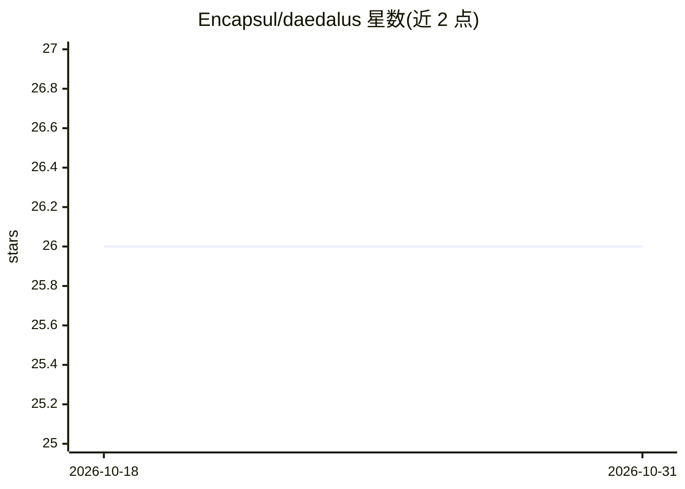

# Encapsul/daedalus

⭐ 26 · Rust · MIT · 推送 2026-10-27 · [GitHub](https://github.com/Encapsul/daedalus) · [官网](https://encapsul.netlify.app) · 个人维护

**把应用打包成单个自解压 Linux ELF 的跨平台 CLI 工具**

Rust 编写的打包 CLI：将应用目录连同运行时打包为单个自解压 Linux ELF（.de 文件），启动时校验 SHA-256、解压到缓存目录后 exec 入口。CLI 本体在 Linux/macOS/Windows 构建，产物仅在 Linux 运行。支持约 20 种运行时检测（Python/Node/Java/Ollama 等），默认 Ed25519 签名、可选 AES-256-GCM 加密、增量更新（SISR）、内容寻址 registry 与 in-toto 证明。限制：冷启动慢于 AppImage/pkg（需解压），加密密钥存于文件元数据。

## 筛选速览

| 维度 | 判定 | 备注 |
|---|---|---|
| AI 角色 | `ai-ecosystem` | LLM/agent 周边工具 |
| 许可风险 | `permissive` | MIT |
| 部署形态 | `library` | 以包/库形式分发 |
| 模型依赖 | local-ok | 支持本地模型 |
| 硬件要求 | — | 无带数字的原话,不猜 |
| 安装摩擦 | `medium` | 含编译或系统依赖之一 |
| 成熟度 | — | 结构信号不足 |

## 能力要点

- 单一 ELF 携带启动器+应用+运行时，仅依赖 Linux 内核
- 默认 Ed25519 签名 + SHA-256 校验，可选 AES-256-GCM 加密
- 检测约 20 种运行时，含 Ollama/Gemma GGUF 离线模型打包
- SISR 增量更新、层热替换与内容寻址 registry

## 适用场景

- 把本地 LLM 应用连模型权重打包成单文件离线分发
- 隔离/边缘环境部署自包含 Linux 应用
- 对分发产物做签名、SBOM 与 in-toto 证明

## 场景标签

 · 领域:应用打包/分发工具

## 证据(README 行号)

> L77: - **Scaffold**: `examples/offline-health-agri` is a standard-library script plus a `Modelfile`. It does not contain
> L78: - **Local model kit** (weights optional): `examples/local-model-kit` — run `./fetch_weights.sh` to pull Gemma 3 270
> L98: |Ollama|`Modelfile`, `models/*.gguf`, `ollama` in `package.json`, or `DAEDALUS_OLLAMA=1`|`ollama serve`|Detection. 

## 星数曲线

2026-10-18 26 → 2026-10-31 26（+0）

---
*卡片 v1 · prompt 1.4 · 生成 2026-10-26 · 置信度 mid · 依据 README sha `b6defd1af917` · [字段定义](../../DATASET.md)*
