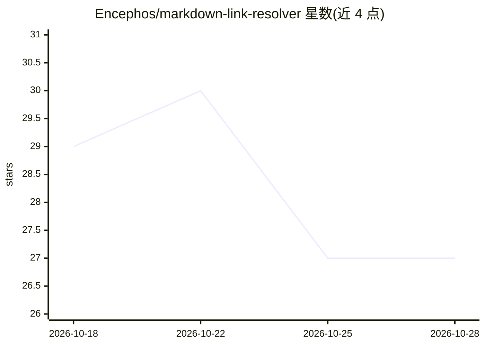

# Encephos/markdown-link-resolver

⭐ 27 · Python · MIT · 推送 2026-08-26 · [GitHub](https://github.com/Encephos/markdown-link-resolver) · 个人维护

**零依赖 Python 工具：解析 Markdown 相对链接并将图片内联为 Base64**

面向 RAG 管道与多模态 LLM 数据准备的微型工具：将 Markdown 文件中的相对链接和图片路径解析为绝对 URL；v0.2.0 起支持把图片自动内联为 Base64 字符串，便于传给 GPT-4o 或 Claude 3.5 等多模态模型。支持传入自定义 HTTP 头（Bearer token、session cookie）下载登录墙后的图片；图片下载超时（5 秒）或 404 时回退为绝对 URL 而不中断管道。通过 pip 安装，零第三方依赖。

## 筛选速览

| 维度 | 判定 | 备注 |
|---|---|---|
| AI 角色 | `ai-ecosystem` | LLM/agent 周边工具 |
| 许可风险 | `permissive` | MIT |
| 部署形态 | `library` | 以包/库形式分发 |
| 模型依赖 | — | README 未给出锁定关系 |
| 硬件要求 | — | 无带数字的原话,不猜 |
| 安装摩擦 | `low` | 无编译、无系统依赖或容器化 |
| 成熟度 | — | 结构信号不足 |

## 能力要点

- 相对链接与图片路径解析为绝对 URL
- 图片自动内联为 Base64 字符串（多模态 LLM 数据准备）
- 自定义 HTTP 头认证下载登录墙后的图片
- 下载超时/404 时回退绝对 URL，不中断管道

## 适用场景

- RAG 入库前清洗抓取到的 Markdown 文档
- 为多模态 LLM 准备含图片的数据
- 抓取需登录的页面图片并转为内联格式

## 场景标签

 · 领域:LLM 数据预处理/RAG

## 证据(README 行号)

> L3: A zero-dependency Python micro-tool to resolve relative links and image paths in Markdown files to absolute URLs. Pe
> L21: If you are passing scraped data to Multimodal LLMs (like GPT-4o or Claude 3.5), you can automatically inline images

## 星数曲线

2026-10-18 29 → 2026-10-28 27（-2）

---
*卡片 v1 · prompt 1.4 · 生成 2026-10-26 · 置信度 high · 依据 README sha `4a903fb1f0b6` · [字段定义](../../DATASET.md)*
