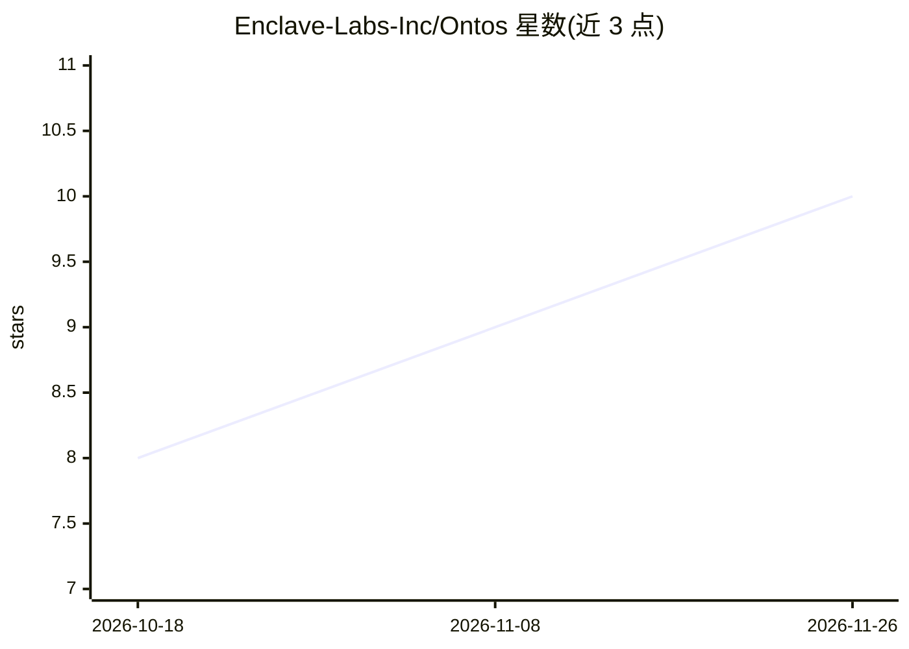

# Enclave-Labs-Inc/Ontos

⭐ 10 · Python · Apache-2.0 · 推送 2026-11-20 · [GitHub](https://github.com/Enclave-Labs-Inc/Ontos) · [官网](https://getenclave.ai) · 组织维护

**企业级知识图谱运行时：VPC 内溯源图谱供 agent 查询**

面向企业的 in-VPC 知识图谱运行时：从文档、通讯、系统记录中抽取类型化实体与关系，以不可变、双时态、带溯源的事实持久化，经 MCP 接口供 LLM agent 查询，遍历时执行权限感知剪枝，每次查询生成合规级审计记录（对齐 EU AI Act Article 12）。默认用 Ollama 做 VPC 内抽取与规划，可选 Anthropic；存储默认本地 NetworkX pickle，可选 Neo4j。0.10.0 含 breaking changes。

## 筛选速览

| 维度 | 判定 | 备注 |
|---|---|---|
| AI 角色 | `ai-ecosystem` | LLM/agent 周边工具 |
| 许可风险 | `permissive` | Apache-2.0 |
| 部署形态 | `self-host` | docker 或自建部署 |
| 模型依赖 | local-ok | 支持本地模型 |
| 硬件要求 | — | 无带数字的原话,不猜 |
| 安装摩擦 | `low` | 无编译、无系统依赖或容器化 |
| 成熟度 | — | 结构信号不足 |

## 能力要点

- 每条事实带 (source_id, extractor_version, confidence, t_valid, t_invalid) 溯源
- 权限感知遍历在执行器内剪枝，零节点存在性泄漏
- 每次查询写 Article-12 审计记录：≥12 字段、≥6 个月保留、按用户归因
- CLI 提供 ingest/query/export/audit verify，导出 Neo4j/GraphML/SVG/JSON-LD

## 适用场景

- 在企业 VPC 内为 agent 提供可审计的公司知识图谱
- 按给定日期回溯某事实当时的权威来源（as_of 读取）
- 跨权限文档做不泄漏的图谱问答
- 导出图谱快照供只读 MCP 服务与可视化

## 场景标签

`知识图谱` `RAG` · 领域:知识与检索

## 证据(README 行号)

> L14: Ontos is an in-VPC knowledge-graph runtime. It:
> L18: 3. **Serves** them to LLM agents through a Model Context Protocol (MCP) interface, with permission-aware graph trav
> L223: 5. **Planner/executor split** — LLM writes typed plans over the ontology; deterministic executor runs multi-hop re

## 星数曲线

2026-10-18 8 → 2026-11-26 10（+2）

---
*卡片 v1 · prompt 1.4 · 生成 2026-11-26 · 置信度 high · 依据 README sha `96747d7b64a5` · [字段定义](../../DATASET.md)*
