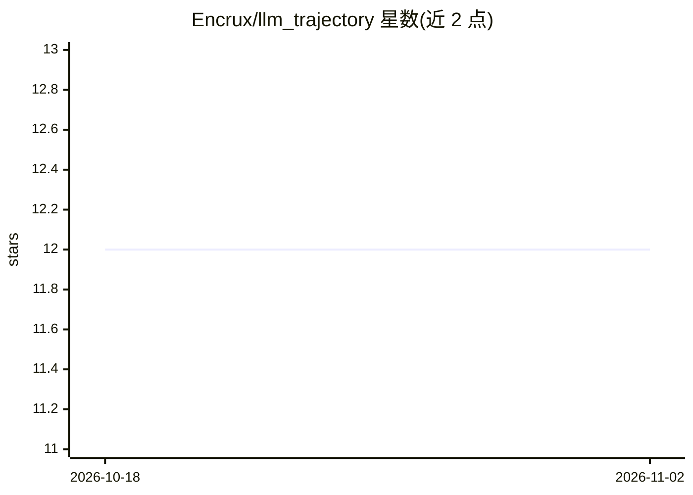

# Encrux/llm_trajectory

⭐ 12 · TypeScript · 推送 2026-07-26 · [GitHub](https://github.com/Encrux/llm_trajectory) · [官网](https://llm-trajectory.boesch.dev/) · 个人维护

**浏览器中用 LLM 把自然语言任务转为机械臂轨迹**

基于 MuJoCo WASM 与 Three.js 的网页应用：用户输入自然语言任务，系统从仿真场景提取物体位置生成文本场景描述，LLM 通过 OpenAI 兼容 API 的 tool calling 返回 pick/place 等原语调用，解析器展开为路径点，动画器用 IK 驱动 Franka Panda 机械臂执行。仿真与渲染全部在浏览器运行，仅 LLM 调用走后端；默认使用作者托管的限流代理（转发至 Groq 免费层），也可配置任意 OpenAI 兼容端点（如 Ollama）。模型须支持 tool calling；推理型模型可能耗尽输出 token 导致无工具调用。

## 筛选速览

| 维度 | 判定 | 备注 |
|---|---|---|
| AI 角色 | `ai-native` | 本体是模型或模型工具 |
| 许可风险 | `none` | — |
| 部署形态 | `library` | 以包/库形式分发 |
| 模型依赖 | local-ok | 支持本地模型 |
| 硬件要求 | — | 无带数字的原话,不猜 |
| 安装摩擦 | `low` | 无编译、无系统依赖或容器化 |
| 成熟度 | — | 结构信号不足 |

## 能力要点

- 自然语言→场景描述→LLM tool calls→机械臂路径点的完整流水线
- MuJoCo WASM + Three.js 浏览器内仿真，无需本地安装仿真环境
- 兼容任意 OpenAI 兼容端点，已知可用模型含 Qwen3、Llama-4、GPT-4o、Ollama 模型
- 可在 primitives.ts 中添加一个函数即扩展新的 LLM 可用原语

## 适用场景

- 输入一句任务描述，在浏览器中观看机械臂执行抓放操作
- 实验不同 LLM 与 tool calling 在机器人任务规划中的表现
- 通过添加自定义原语扩展机械臂可执行的动作集合

## 场景标签

 · 领域:机器人/仿真

## 证据(README 行号)

> L3: Natural language to robot trajectory. Type a task, watch a Franka Panda execute it.
> L60: 2. **LLM** receives a text scene description + tool definitions, returns tool calls like `pick("Red Cube")`, `place
> L61: 3. **Resolver** expands tool calls into waypoints (name to coordinates, higher-order primitives to atomic steps)

## 星数曲线

2026-10-18 12 → 2026-11-02 12（+0）

---
*卡片 v1 · prompt 1.4 · 生成 2026-11-01 · 置信度 mid · 依据 README sha `4ec7afffebf1` · [字段定义](../../DATASET.md)*
