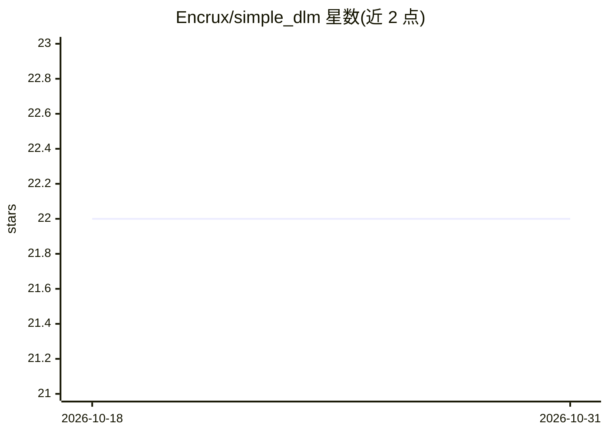

# Encrux/simple_dlm

⭐ 22 · Python · 推送 2026-06-29 · [GitHub](https://github.com/Encrux/simple_dlm) · 个人维护

**手工实现的扩散语言模型：从 txt 语料训练并采样生成文本**

作者从零手写实现的离散扩散语言模型（discrete diffusion LM）训练项目：用户提供单个 .txt 训练语料（如 tiny Shakespeare），通过 uv 管理依赖，运行 train 脚本在 cuda/mps/cpu 设备上训练，模型以 checkpoint 保存并可被新训练覆盖；支持 sample 命令从提示词采样生成文本，以及导出 ONNX。README 展示了训练至 step 67000/77000 的采样输出，训练在 M2 Air 16GB 上进行。无预训练模型发布说明。

## 筛选速览

| 维度 | 判定 | 备注 |
|---|---|---|
| AI 角色 | `ai-native` | 本体是模型或模型工具 |
| 许可风险 | `none` | — |
| 部署形态 | `None` |  |
| 模型依赖 | — | README 未给出锁定关系 |
| 硬件要求 | — | 无带数字的原话,不猜 |
| 安装摩擦 | `medium` | 含编译或系统依赖之一 |
| 成熟度 | — | 结构信号不足 |

## 能力要点

- 从零手工实现的扩散语言模型，代码自含训练/采样/导出流程
- 支持 cuda/mps/cpu 设备选择
- 可导出 ONNX 格式
- uv 管理依赖，单 txt 文件作为训练语料

## 适用场景

- 学习扩散语言模型的实现原理
- 在小规模语料上实验训练自己的小型语言模型
- 将训练好的模型导出 ONNX 做后续部署实验

## 场景标签

`模型训练` · 领域:训练与推理

## 证据(README 行号)

> L46: uv run train --device cuda (or mps/cpu)
> L52: uv run sample --query "To be, "

## 星数曲线

2026-10-18 22 → 2026-10-31 22（+0）

---
*卡片 v1 · prompt 1.4 · 生成 2026-10-27 · 置信度 mid · 依据 README sha `03da68718ba7` · [字段定义](../../DATASET.md)*
