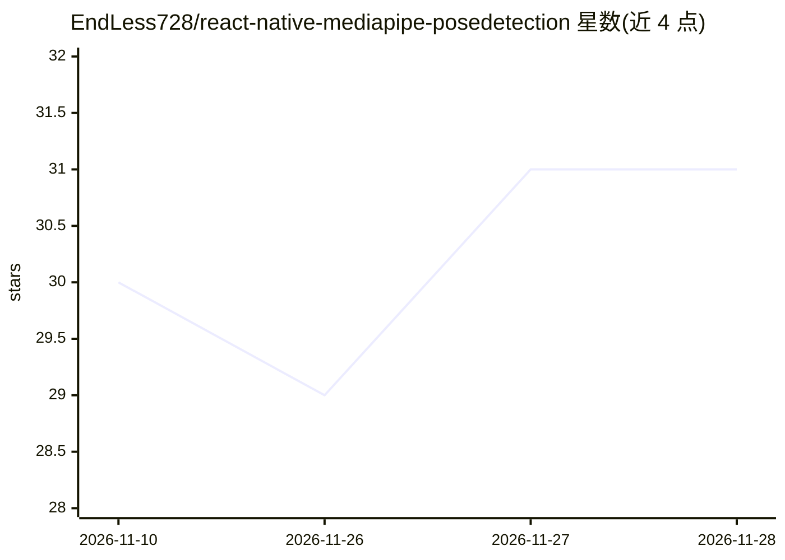

# EndLess728/react-native-mediapipe-posedetection

⭐ 31 · TypeScript · MIT · 推送 2026-11-26 · [GitHub](https://github.com/EndLess728/react-native-mediapipe-posedetection) · [官网](https://endless728.github.io/react-native-mediapipe-posedetection/) · 个人维护

**React Native 实时人体姿态检测库：MediaPipe 33 个关键点**

面向 React Native/Expo 移动开发者的姿态检测库，封装 Google MediaPipe Pose Landmarker 模型，通过 VisionCamera frame processor 实现实时摄像头姿态检测，每检测到的人输出 33 个身体关键点，也支持静态图片检测。提供 usePoseDetection 等 React hooks 与 MediapipeCamera 组件，支持 GPU 加速、FPS 节流与多人数配置。限定必须启用 React Native 0.74+ 的 New Architecture（TurboModules），iOS/Android 双端支持，附 Expo config plugin 自动复制模型文件。

## 筛选速览

| 维度 | 判定 | 备注 |
|---|---|---|
| AI 角色 | `ai-native` | 本体是模型或模型工具 |
| 许可风险 | `permissive` | MIT |
| 部署形态 | `library` | 以包/库形式分发 |
| 模型依赖 | — | README 未给出锁定关系 |
| 硬件要求 | — | 无带数字的原话,不猜 |
| 安装摩擦 | `low` | 无编译、无系统依赖或容器化 |
| 成熟度 | — | 结构信号不足 |

## 能力要点

- 实时检测 33 个人体姿态关键点，支持多人检测
- 基于 react-native-vision-camera frame processor，支持 GPU delegate 与 fpsMode 节流
- 静态图片检测（PoseDetectionOnImage）与 KnownPoseLandmarks 关键点索引
- Expo config plugin 在 prebuild 时自动复制模型文件到原生工程

## 适用场景

- 在健身或运动类 App 中实时追踪用户身体姿态
- 从照片或视频帧中提取人体关键点坐标
- 构建需要姿态数据输入的 React Native/Expo 应用

## 场景标签

`目标检测` · 领域:感知与多模态

## 证据(README 行号)

> L7: High-performance pose detection for React Native using Google's MediaPipe models with optimized frame processing for
> L19: - ✨ Real-time pose detection via `react-native-vision-camera`
> L20: - 🎯 33 pose landmarks per detected person

## 星数曲线

2026-11-10 30 → 2026-11-28 31（+1）

---
*卡片 v1 · prompt 1.4 · 生成 2026-11-18 · 置信度 high · 依据 README sha `63cf1fc490e2` · [字段定义](../../DATASET.md)*
