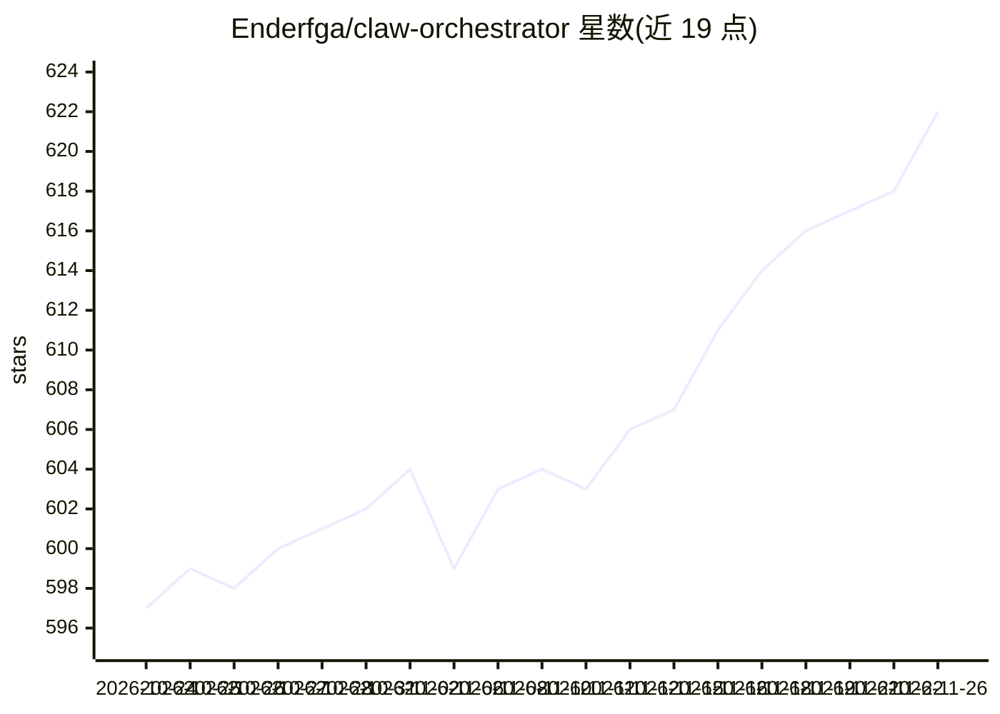

# Enderfga/claw-orchestrator

⭐ 622 · TypeScript · MIT · 推送 2026-11-24 · [GitHub](https://github.com/Enderfga/claw-orchestrator) · [官网](https://github.com/Enderfga/claw-orchestrator#readme) · 个人维护

**统一运行时调度 Claude Code/Codex 等编码 agent 并独立验证结果**

面向开发者的编码 agent 编排运行时：把 Claude Code、Codex、Antigravity、Grok Build、OpenCode 及任意 ACP agent 作为持久会话接入同一套 CLI/API，支持跨引擎 fan-out、会话切换、council 共识与无人值守 goal 模式。核心机制是由运行时本身执行验收契约（命令、HTTP 探针、截图、diff 策略），运行结束给出 verified/refuted/unverified 判定，agent 无法自行改写检查。每次调用记录模型、token 与费用，支持 maxBudgetUsd 花费上限；工作流带检查点，进程崩溃后可恢复。需要 Node 22+ 与至少一个已登录的引擎 CLI。

## 筛选速览

| 维度 | 判定 | 备注 |
|---|---|---|
| AI 角色 | `ai-ecosystem` | LLM/agent 周边工具 |
| 许可风险 | `permissive` | MIT |
| 部署形态 | `library` | 以包/库形式分发 |
| 模型依赖 | — | README 未给出锁定关系 |
| 硬件要求 | — | 无带数字的原话,不猜 |
| 安装摩擦 | `low` | 无编译、无系统依赖或容器化 |
| 成熟度 | — | 结构信号不足 |

## 能力要点

- 运行时自行执行验收契约并给出 verified/refuted/unverified 判定
- 多引擎接入同一 API：--codex/--agy 等选择引擎，clawo fanout 并行分发
- 跨引擎会话切换（session_handoff）与崩溃后可恢复的检查点工作流
- JSONL 运行账本按模型对比 verified 率与费用，支持 maxBudgetUsd 上限

## 适用场景

- 让 agent 修 bug 后由运行时跑独立测试验证是否真的通过
- 同一任务并行发给多个引擎对比结果
- 给无人值守长任务设定预算上限并留存费用账本
- 在编辑器中通过 MCP/ACP 接入统一的多引擎 agent 入口

## 场景标签

`多智能体` `编码 Agent` `模型评测` · 领域:Agent 开发

## 证据(README 行号)

> L3:  Claw Orchestrator: A Unified Runtime for Coding Agent CLIs
> L17: Agent Client Protocol agent (Kimi Code, dsh) as persistent sessions behind one API.
> L18: A run counts as done only when checks the agent did not write pass: you declare the checks, the runtime runs them

## 星数曲线

2026-10-24 597 → 2026-11-26 622（+25）

---
*卡片 v1 · prompt 1.4 · 生成 2026-11-26 · 置信度 high · 依据 README sha `ad43cc91dff6` · [字段定义](../../DATASET.md)*
