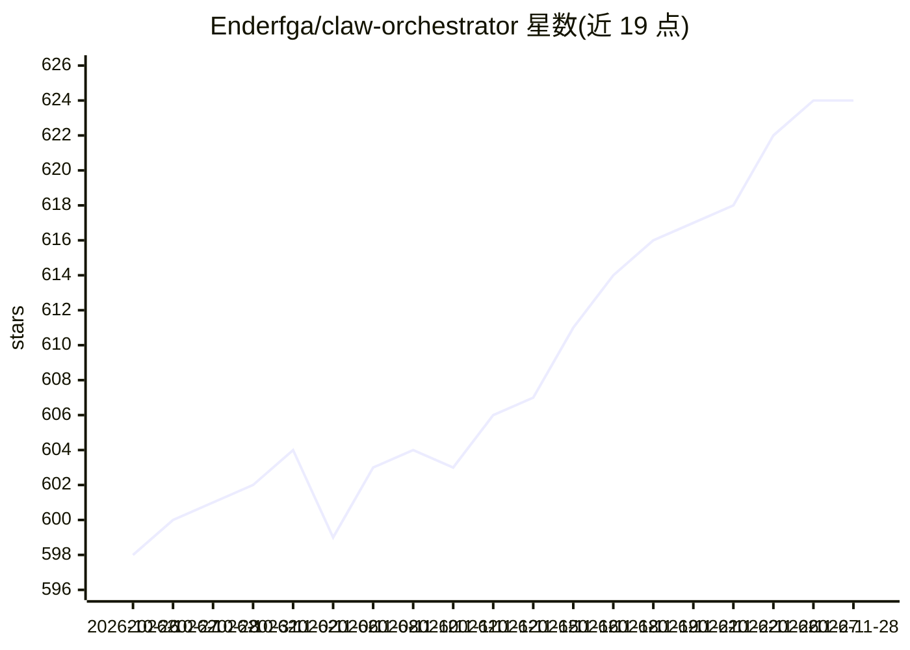

# Enderfga/claw-orchestrator

⭐ 624 · TypeScript · MIT · 推送 2026-11-27 · [GitHub](https://github.com/Enderfga/claw-orchestrator) · [官网](https://github.com/Enderfga/claw-orchestrator#readme) · 个人维护

**统一运行时编排多个编码 Agent CLI 并执行独立验收校验**

将 Claude Code、Codex、Antigravity、Grok Build、Cursor、OpenCode 及任意 ACP agent 作为持久会话接入同一 API，提供 CLI、MCP server、ACP agent、OpenAI 兼容端点和 TypeScript SDK 等运行方式。核心机制是验收契约：由运行时而非 agent 自身执行检查命令，运行结果判定为 verified/refuted/unverified。支持 fan-out 多引擎并行、session handoff、checkpoint 恢复、按 turn 记录模型/令牌/成本的账本与 maxBudgetUsd 支出上限。需要 Node 22+ 且至少安装并登录一个引擎 CLI。

## 筛选速览

| 维度 | 判定 | 备注 |
|---|---|---|
| AI 角色 | `ai-ecosystem` | LLM/agent 周边工具 |
| 许可风险 | `permissive` | MIT |
| 部署形态 | `library` | 以包/库形式分发 |
| 模型依赖 | — | README 未给出锁定关系 |
| 硬件要求 | — | 无带数字的原话,不猜 |
| 安装摩擦 | `low` | 无编译、无系统依赖或容器化 |
| 成熟度 | — | 结构信号不足 |

## 能力要点

- 由运行时执行、agent 不可编辑的验收契约校验
- 多引擎统一 API：fan-out 并行与会话跨引擎交接
- checkpoint 持久化运行，崩溃后可恢复
- 跨引擎成本账本与 maxBudgetUsd 支出上限

## 适用场景

- 让不同厂商的编码 agent 在统一接口下完成修复任务并接受独立校验
- 同一任务分发到多个引擎对比结果与成本
- 长时无人值守目标执行，用量限额后自动恢复
- 在编辑器中通过 MCP/ACP 切换多个 agent 模型

## 场景标签

`多智能体` `编码 Agent` · 领域:Agent 开发

## 证据(README 行号)

> L3:  Claw Orchestrator: A Unified Runtime for Coding Agent CLIs
> L63: subagents and Codex's parallel attempts stay within one vendor. Claw Orchestrator is a headless runtime underneath:
> L69: Requires Node 22+ and at least one engine CLI installed and logged in (`claude`, `codex`, `agy`, `grok` or `opencod

## 星数曲线

2026-10-26 598 → 2026-11-28 624（+26）

---
*卡片 v1 · prompt 1.4 · 生成 2026-11-28 · 置信度 high · 依据 README sha `e61c48a9cfe6` · [字段定义](../../DATASET.md)*
