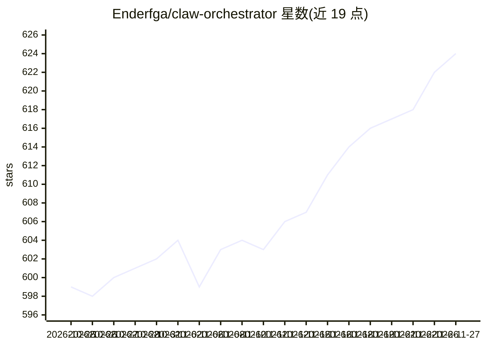

# Enderfga/claw-orchestrator

⭐ 624 · TypeScript · MIT · 推送 2026-11-26 · [GitHub](https://github.com/Enderfga/claw-orchestrator) · [官网](https://github.com/Enderfga/claw-orchestrator#readme) · 个人维护

**为开发者提供统一运行时，调度多种编码 Agent CLI 并独立验收**

一个把 Claude Code、Codex、Antigravity、Grok Build、Cursor、OpenCode 及任意 ACP agent 作为持久会话运行在单一 API 之后的编码 Agent 运行时。核心机制：由运行时（而非 agent 自身）执行验收契约并读取退出码，运行结果分 verified/refuted/unverified；支持跨引擎 fan-out、council 投票、会话跨引擎移交、检查点恢复、按引擎记录 token 与成本并强制 maxBudgetUsd 上限。需要 Node 22+ 且至少安装并登录一个引擎 CLI。

## 筛选速览

| 维度 | 判定 | 备注 |
|---|---|---|
| AI 角色 | `ai-ecosystem` | LLM/agent 周边工具 |
| 许可风险 | `permissive` | MIT |
| 部署形态 | `library` | 以包/库形式分发 |
| 模型依赖 | — | README 未给出锁定关系 |
| 硬件要求 | — | 无带数字的原话,不猜 |
| 安装摩擦 | `low` | 无编译、无系统依赖或容器化 |
| 成熟度 | — | 结构信号不足 |

## 能力要点

- 运行时自身执行验收契约，agent 无法编辑判定依据
- 多引擎统一 CLI 旗标，支持 fanout 与 session_handoff
- 检查点化工作流，进程崩溃后可恢复
- MCP server、ACP agent、OpenAI 兼容端点、TypeScript SDK 多种接入方式

## 适用场景

- 同一任务分发给多个编码 Agent 并行执行并汇总
- 无人值守的长目标任务需在用量限额后自动续跑
- 按 verified 率和成本对比不同引擎/模型
- 在编辑器（Zed/JetBrains/Neovim）中切换多家编码 Agent

## 场景标签

`多智能体` `Agent 框架` · 领域:Agent 开发

## 证据(README 行号)

> L3:  Claw Orchestrator: A Unified Runtime for Coding Agent CLIs
> L17: Agent Client Protocol agent (Kimi Code, dsh) as persistent sessions behind one API.
> L63: subagents and Codex's parallel attempts stay within one vendor. Claw Orchestrator is a headless runtime underneath:

## 星数曲线

2026-10-25 599 → 2026-11-27 624（+25）

---
*卡片 v1 · prompt 1.4 · 生成 2026-11-27 · 置信度 high · 依据 README sha `12654a62e4f0` · [字段定义](../../DATASET.md)*
