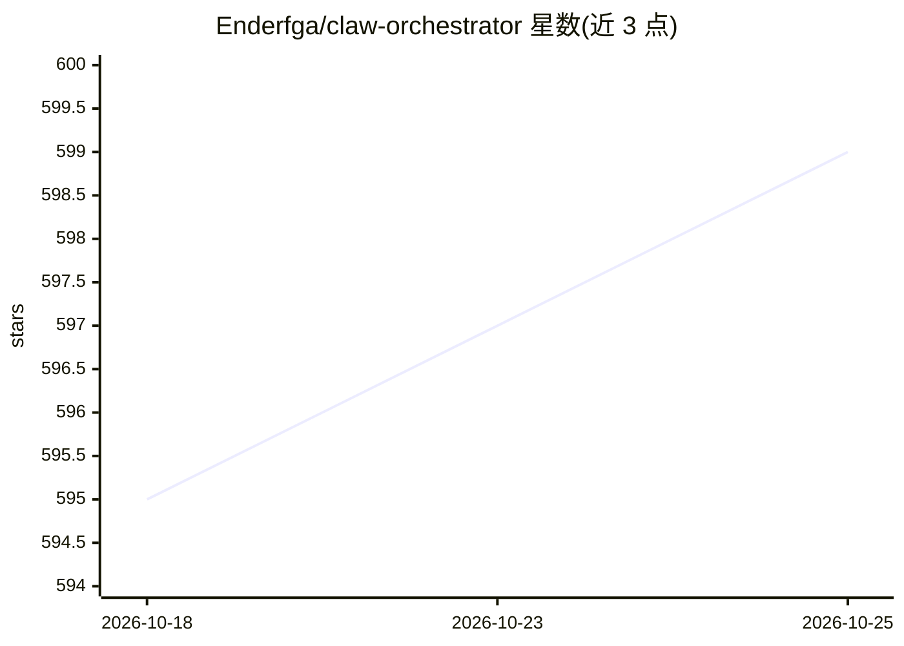

# Enderfga/claw-orchestrator

⭐ 598 · TypeScript · MIT · 推送 2026-10-24 · [GitHub](https://github.com/Enderfga/claw-orchestrator) · [官网](https://github.com/Enderfga/claw-orchestrator#readme) · 个人维护

**多引擎编码代理运行时：统一运行并验证 Claude/Codex 等代理的产出**

以 Node CLI 形式提供的 headless 运行时，把 Claude Code、Codex、Antigravity、Grok Build、OpenCode 及自定义 CLI 包装在统一接口后面，维持持久会话。核心机制是验收契约：用户声明检查（命令、HTTP 探测、截图、文件断言），由运行时自行执行并读取退出码，运行结果判定为 verified/refuted/unverified，代理无法通过编辑测试自证通过。另提供 fan-out、多代理 council、会话跨引擎交接、检查点化的持久工作流、逐轮费用账本与 maxBudgetUsd 支出上限，以及 MCP 服务器、ACP agent、OpenAI 兼容端点与 TypeScript SDK。要求 Node 22+ 且至少安装并登录一个引擎 CLI。

## 筛选速览

| 维度 | 判定 | 备注 |
|---|---|---|
| AI 角色 | `ai-ecosystem` | LLM/agent 周边工具 |
| 许可风险 | `permissive` | MIT |
| 部署形态 | `library` | 以包/库形式分发 |
| 模型依赖 | — | README 未给出锁定关系 |
| 硬件要求 | — | 无带数字的原话,不猜 |
| 安装摩擦 | `low` | 无编译、无系统依赖或容器化 |
| 成熟度 | — | 结构信号不足 |

## 能力要点

- 统一接口运行 5 种编码代理引擎与自定义 CLI，支持 fan-out 与多代理 council 投票
- 验收契约由运行时执行，结果为 verified/refuted/unverified，代理无法编辑测试自证
- 检查点化持久工作流：重启后在节点边界恢复，支持重试/超时/取消/引导
- 逐轮 JSONL 费用账本与 maxBudgetUsd 支出上限，跨引擎生效
- 提供 MCP 服务器、ACP agent、OpenAI 兼容代理端点与 78 工具面

## 适用场景

- 让多个厂商的编码代理执行同一任务并汇总对比回答
- 用自己声明的检查命令核验代理声称的“测试全部通过”
- 任务中途把卡住的会话从 Claude 交接到 Codex 继续执行
- 给跨引擎的代理运行设置预算上限并事后查询花费

## 场景标签

`编码 Agent` `多智能体` `Agent 框架` · 领域:Agent 开发

## 证据(README 行号)

> L22: Coding agents grade their own work: "All tests pass ✓". Claw Orchestrator runs them as persistent sessions behind o
> L36: |Use more than one vendor|Persistent sessions for Claude Code, Codex, Antigravity, Grok Build, OpenCode and custom 
> L40: |Call it from your own tools|An MCP server (`clawo-mcp`), an ACP agent (`clawo acp`) for Zed, JetBrains and other A

## 星数曲线

2026-10-18 595 → 2026-10-25 599（+4）

---
*卡片 v1 · prompt 1.4 · 生成 2026-10-21 · 置信度 high · 依据 README sha `14f2d93384ce` · [字段定义](../../DATASET.md)*
