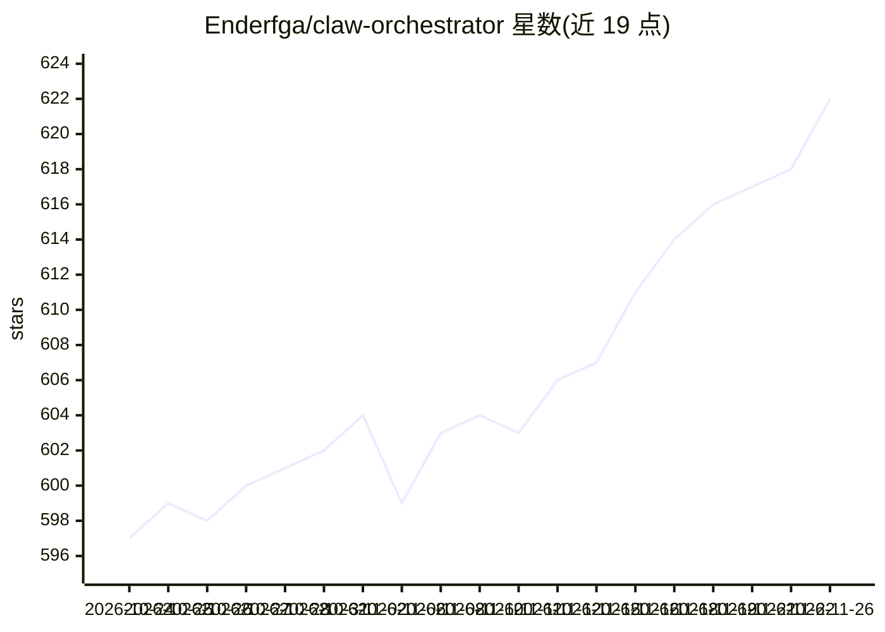

# Enderfga/claw-orchestrator

⭐ 622 · TypeScript · MIT · 推送 2026-11-24 · [GitHub](https://github.com/Enderfga/claw-orchestrator) · [官网](https://github.com/Enderfga/claw-orchestrator#readme) · 个人维护

**为开发者统一调度多个编码 agent CLI 并独立验收结果的运行时**

以 Node 运行时形式将 Claude Code、Codex、Antigravity、Grok Build、OpenCode 及任意 ACP agent 作为持久会话收拢到一套 API/CLI 之后。核心机制是验收合同：检查命令由运行时而非 agent 执行，运行结果判为 verified/refuted/unverified，证据落盘。支持跨引擎 fan-out、council 投票、会话交接、崩溃恢复检查点、按轮次记录模型/token/成本的账本与 maxBudgetUsd 花费上限。提供 CLI、MCP server、ACP agent、OpenAI 兼容端点与 TypeScript SDK。

## 筛选速览

| 维度 | 判定 | 备注 |
|---|---|---|
| AI 角色 | `ai-ecosystem` | LLM/agent 周边工具 |
| 许可风险 | `permissive` | MIT |
| 部署形态 | `library` | 以包/库形式分发 |
| 模型依赖 | — | README 未给出锁定关系 |
| 硬件要求 | — | 无带数字的原话,不猜 |
| 安装摩擦 | `low` | 无编译、无系统依赖或容器化 |
| 成熟度 | — | 结构信号不足 |

## 能力要点

- 运行时自身执行验收合同检查，agent 无法改写判定
- 多引擎统一 CLI 标志，fanout 并行与 session_handoff 跨引擎交接
- 检查点化持久运行，崩溃后可恢复
- 跨引擎账本记录每轮模型、token、成本并强制预算上限

## 适用场景

- 让编码 agent 修复测试并用独立检查验证结果
- 同一任务分发给多个引擎并行比较
- 无人值守长目标运行并控制花费
- 在编辑器中通过 MCP/ACP 调用统一 agent 入口

## 场景标签

`编码 Agent` `多智能体` · 领域:Agent 开发

## 证据(README 行号)

> L16: **Claw Orchestrator** runs Claude Code, Codex, Antigravity, Grok Build, OpenCode and any
> L57: - 🔌 **Fits your tools**: a CLI, an MCP server, an ACP agent for editors, an OpenAI-compatible endpoint, a TypeScrip
> L152: |**Multi-engine runtime**|One interface and one set of CLI flags over the engines above, any ACP agent, and custom

## 星数曲线

2026-10-24 597 → 2026-11-26 622（+25）

---
*卡片 v1 · prompt 1.4 · 生成 2026-11-25 · 置信度 high · 依据 README sha `37def77f27ca` · [字段定义](../../DATASET.md)*
