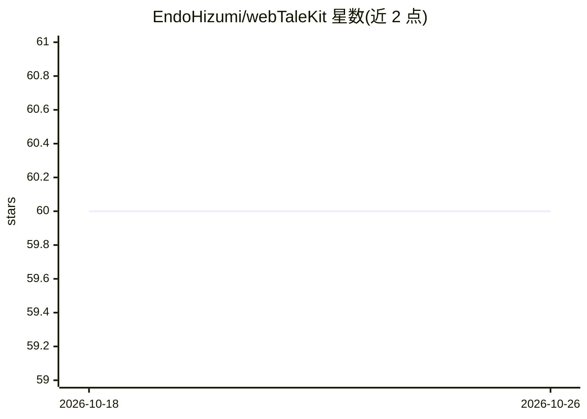

# EndoHizumi/webTaleKit

⭐ 60 · TypeScript · MIT · 推送 2026-10-05 · [GitHub](https://github.com/EndoHizumi/webTaleKit) · [官网](https://endohizumi.github.io/webTaleKit/) · 个人维护

**TypeScript 视觉小说游戏引擎：HTML/CSS 自定义 UI，可接 LLM 对话**

基于 TypeScript(JavaScript) 的视觉小说（galgame）游戏引擎。UI 用普通 HTML/CSS/JavaScript 制作，自动缩放适配窗口；剧本用 HTML 风格的 WebTaleScript 标记编写，可用 TypeScript/JavaScript 扩展，任何标签都可通过 get/post/put/delete 属性调用 REST API 并把响应展示为台词，仓库附带 OpenAI 兼容中继服务器，可对接 llama.cpp server、Ollama、LM Studio、Gemini、OpenAI，实现角色与 LLM 对话。面向游戏开发者，当前为 alpha 版，桌面与移动端构建尚未支持，通过 npm 脚手架安装。

## 筛选速览

| 维度 | 判定 | 备注 |
|---|---|---|
| AI 角色 | `ai-enhanced` | 去掉 AI 部分产品仍成立 |
| 许可风险 | `permissive` | MIT |
| 部署形态 | `library` | 以包/库形式分发 |
| 模型依赖 | local-ok | 支持本地模型 |
| 硬件要求 | — | 无带数字的原话,不猜 |
| 安装摩擦 | `low` | 无编译、无系统依赖或容器化 |
| 成熟度 | `idea` | |

## 能力要点

- UI 完全用 HTML/CSS/JavaScript 自定义，支持 Vue/React 等框架经 EventBus 嵌入
- 全标签通用 HTTP 属性调用 REST API，LLM 响应可直接作为角色台词
- 附带 OpenAI 兼容中继服务器（server/chat.js），支持本地 LLM 无 API key 运行
- 提供剧本校验与净化公开 API（validateScenarioObjects 等）

## 适用场景

- 开发网页端视觉小说/galgame，用熟悉的 HTML/CSS 定制界面
- 让游戏角色调用 LLM API 实现动态对话
- 替换图片、BGM 与剧本文本进行低门槛定制

## 场景标签

 · 领域:游戏开发/互动叙事

## 证据(README 行号)

> L13: TypeScript(JavaScript) ベースのビジュアルノベルゲームエンジンです。
> L17: - **シナリオからJSのメソッドやREST API(POSTを含む)を呼べます。** レスポンスは変数 `res` に入るので、LLMの応答をそのままキャラクターのセリフにできます(LLMと会話する)。
> L30: - 🤖 **LLM連携**: 全タグ共通のHTTP属性(`get` / `post` / `put` / `delete`)でLLMのAPIを呼び、応答をセリフとして表示

## 星数曲线

2026-10-18 60 → 2026-10-26 60（+0）

---
*卡片 v1 · prompt 1.4 · 生成 2026-10-24 · 置信度 high · 依据 README sha `96f5730ce1f5` · [字段定义](../../DATASET.md)*
