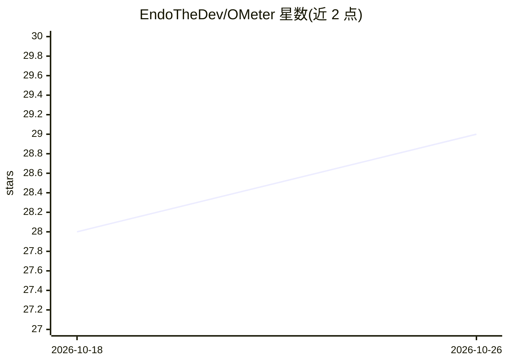

# EndoTheDev/OMeter

⭐ 29 · Python · MIT · 推送 2026-10-25 · [GitHub](https://github.com/EndoTheDev/OMeter) · 个人维护

**Ollama 模型性能基准测试 CLI：跨本地与云端测 TTFT/TPS**

面向使用 Ollama 的开发者的 Python 命令行工具：列出本地与云端端点的模型，测量 TTFT（首 token 时间）与 TPS（每秒 token 数），每模型默认 3 条 prompt 取平均，支持并行、自定义 prompt、按名称/大小/上下文长度/指标排序，并导出 JSON/CSV。历史结果自动存入本地 SQLite，与公开 Web 仪表盘合并并显示趋势箭头。云端基准测试需配置 API key，通过 uv 或 pip 安装。

## 筛选速览

| 维度 | 判定 | 备注 |
|---|---|---|
| AI 角色 | `ai-ecosystem` | LLM/agent 周边工具 |
| 许可风险 | `permissive` | MIT |
| 部署形态 | `library` | 以包/库形式分发 |
| 模型依赖 | local-ok | 支持本地模型 |
| 硬件要求 | — | 无带数字的原话,不猜 |
| 安装摩擦 | `low` | 无编译、无系统依赖或容器化 |
| 成熟度 | — | 结构信号不足 |

## 能力要点

- 测量 TTFT 与 TPS，每模型默认 3 条 prompt 平均，支持最多 10 并行
- 基准历史存入本地 SQLite，趋势箭头（↑↓→）自动内联显示
- 结果导出 JSON/CSV，支持按名称精确或 family 匹配过滤模型
- 本地 embedding 模型自动走 /api/embed 端点

## 适用场景

- 对比本地与云端 Ollama 模型的生成速度，辅助选型
- 跟踪同一模型多次基准测试的性能趋势
- 导出基准数据到 JSON/CSV 做进一步分析

## 场景标签

`模型评测` · 领域:评测与运维

## 证据(README 行号)

> L6: Benchmark and compare Ollama models across local and cloud endpoints with rich, sortable tables.
> L14: - ⏱️ **Benchmark** time-to-first-token (TTFT) and tokens-per-second (TPS)
> L273: - **api.py** — HTTP communication with Ollama, TTFT/TPS measurement

## 星数曲线

2026-10-18 28 → 2026-10-26 29（+1）

---
*卡片 v1 · prompt 1.4 · 生成 2026-10-26 · 置信度 high · 依据 README sha `33570a959732` · [字段定义](../../DATASET.md)*
