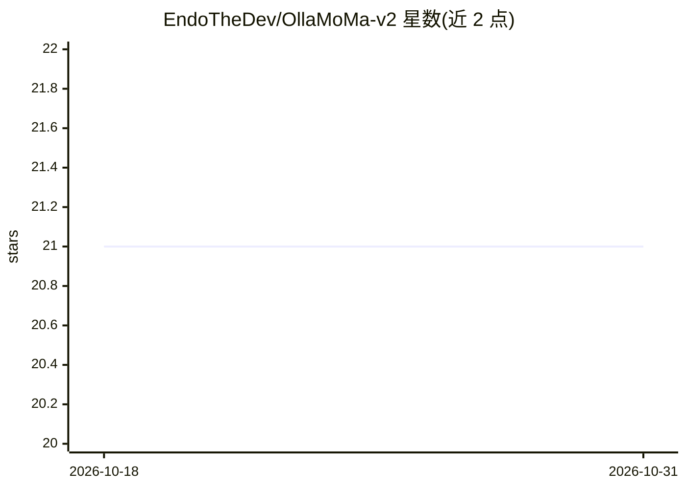

# EndoTheDev/OllaMoMa-v2

⭐ 21 · Vue · 推送 2026-05-10 · [GitHub](https://github.com/EndoTheDev/OllaMoMa-v2) · 个人维护

**本地 Ollama 实例的 Web 聊天与管理界面**

基于 Nuxt 4、Nuxt UI v4 与 Tailwind CSS 构建的 Web 前端，连接本地运行的 Ollama 后端，提供实时流式聊天、多模型切换、模型查看/搜索/排序、深浅色主题与响应式布局。前置条件为 Node.js v18+ 与本地已运行的 Ollama（默认 127.0.0.1:11434）。支持 npm/pnpm 等本地开发流程与 Docker、Docker Compose 两种容器部署方式。README 标注项目为 Work in Progress，路线图中列有 LangChain 集成与知识图谱可视化等待开发项。

## 筛选速览

| 维度 | 判定 | 备注 |
|---|---|---|
| AI 角色 | `ai-ecosystem` | LLM/agent 周边工具 |
| 许可风险 | `none` | — |
| 部署形态 | `self-host` | docker 或自建部署 |
| 模型依赖 | local-ok | 支持本地模型 |
| 硬件要求 | — | 无带数字的原话,不猜 |
| 安装摩擦 | `low` | 无编译、无系统依赖或容器化 |
| 成熟度 | `idea` | |

## 能力要点

- 实时流式响应的聊天界面，支持多模型
- Ollama 模型的查看、搜索、排序与管理
- 深浅色模式与可定制主题的响应式 UI
- 提供 Docker 与 Docker Compose 部署方式

## 适用场景

- 为本地 Ollama 提供浏览器端的图形聊天界面
- 在网页中管理本地模型（查看、搜索、排序）
- 用 Docker 容器化部署前端并连接主机上的 Ollama

## 场景标签

`聊天机器人` · 领域:对话与助手

## 证据(README 行号)

> L3: > A modern web interface for interacting with Ollama models, built with Nuxt 4 and Nuxt UI v4.
> L35: - **LLM Backend**: Ollama

## 星数曲线

2026-10-18 21 → 2026-10-31 21（+0）

---
*卡片 v1 · prompt 1.4 · 生成 2026-10-28 · 置信度 high · 依据 README sha `a3f0af5c1266` · [字段定义](../../DATASET.md)*
