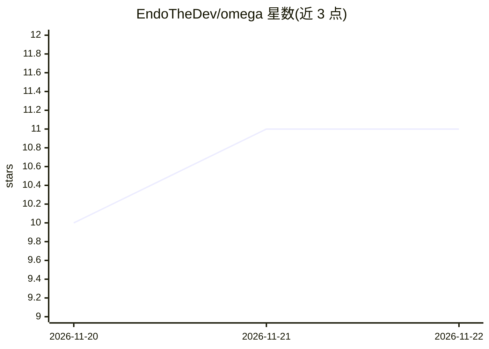

# EndoTheDev/omega

⭐ 11 · Go · MIT · 推送 2026-11-21 · [GitHub](https://github.com/EndoTheDev/omega) · 个人维护

**自托管 AI agent 平台：单二进制 CLI+WebUI，多 LLM 路由**

以 Go 编写的自托管 AI agent 平台：读取文件、运行命令、编辑代码，向 Ollama/OpenAI/Anthropic 等 LLM 提供方流式请求。单二进制提供两种形态：CLI agent 循环（首次运行进入设置向导）与 `omega serve` 启动的 WebUI，后者含持久会话、上下文压缩、VS Code 风格可拖拽面板、文件管理器、终端、审批门、看板与多命名 agent 并行运行。对话可分支（每次重试为可切换变体），agent 可通过判定卡中途询问。注意：shell 工具无沙箱执行 LLM 生成的命令，敏感场景建议用本地 Ollama。

## 筛选速览

| 维度 | 判定 | 备注 |
|---|---|---|
| AI 角色 | `ai-ecosystem` | LLM/agent 周边工具 |
| 许可风险 | `permissive` | MIT |
| 部署形态 | `library` | 以包/库形式分发 |
| 模型依赖 | local-ok | 支持本地模型 |
| 硬件要求 | — | 无带数字的原话,不猜 |
| 安装摩擦 | `low` | 无编译、无系统依赖或容器化 |
| 成熟度 | `idea` | |

## 能力要点

- 单二进制含 CLI agent 与嵌入式 WebUI 两种形态
- 多提供方 LLM 流式路由：Ollama + OpenAI + Anthropic
- 对话分支、判定卡交互、风险命令审批门、临时会话
- 进程内 Go 模块系统与多命名 agent 并行

## 适用场景

- 自托管一个可读写文件、执行命令的终端 agent
- 在浏览器中管理多会话与多 agent 的 LLM 工作台
- 敏感数据场景下用本地 Ollama 避免内容上云

## 场景标签

`编码 Agent` `AI 助手` · 领域:编码与开发

## 证据(README 行号)

> L9: omega is an AI assistant that reads files, runs
> L10: commands, and edits code. It talks to LLM providers (Ollama, OpenAI,
> L76: HTTP channel -> agent (loop + tools) -> llm (provider streaming)

## 星数曲线

2026-11-20 10 → 2026-11-22 11（+1）

---
*卡片 v1 · prompt 1.4 · 生成 2026-11-20 · 置信度 high · 依据 README sha `bb550d44abb3` · [字段定义](../../DATASET.md)*
