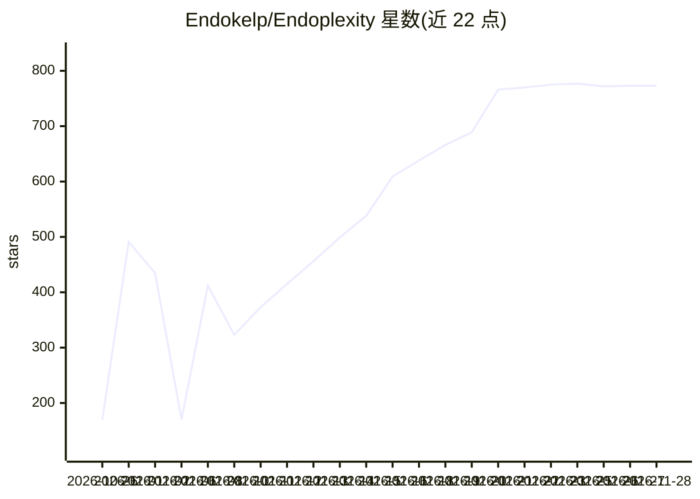

# Endokelp/Endoplexity

⭐ 773 · TypeScript · Apache-2.0 · 推送 2026-11-09 · [GitHub](https://github.com/Endokelp/Endoplexity) · 个人维护

**用已有 Claude/Cursor 订阅驱动自有 Chrome 的浏览器 agent**

由 Chrome 扩展、本地 bridge 与 CLI 组成的浏览器自动化工具：扩展侧边栏接收指令，本地 bridge 通过 origin 绑定的 WebSocket 提供 18 个浏览器工具，经 token 门控 MCP 交由用户已登录的 claude、cursor-agent 或 codex CLI 运行 agent 循环。页面以文本大纲而非截图提供给模型；不可逆操作需用户批准，且由另一家模型预读检查；完成的任务可存为 skill 离线重放。需 Node 24+、Chrome 114+，Apache-2.0 许可。

## 筛选速览

| 维度 | 判定 | 备注 |
|---|---|---|
| AI 角色 | `ai-native` | 本体是模型或模型工具 |
| 许可风险 | `permissive` | Apache-2.0 |
| 部署形态 | `library` | 以包/库形式分发 |
| 模型依赖 | locked-api |  |
| 硬件要求 | — | 无带数字的原话,不猜 |
| 安装摩擦 | `low` | 无编译、无系统依赖或容器化 |
| 成熟度 | `idea` | |

## 能力要点

- 复用用户已有的 claude/cursor-agent/codex CLI 订阅，无需 API key
- 页面内容以文本大纲提供给模型，不发送截图
- 不可逆操作需批准，规则存于本地代码
- 完成的任务可保存为 skill，重放时不调用模型

## 适用场景

- 让 agent 在自己日常使用的 Chrome 配置文件里执行网页任务
- 以已有订阅计划运行浏览器自动化而不产生额外 API 费用
- 把完成过的网页任务保存为可重放的 skill

## 场景标签

`浏览器自动化` · 领域:效率与自动化

## 证据(README 行号)

> L91: The Chrome side panel talks to a local bridge over an origin-pinned WebSocket; the bridge serves 18 browser tools o
> L122: You need Node 24+, Chrome 114+, and one of the `claude`, `cursor-agent` or

## 星数曲线

2026-10-26 170 → 2026-11-28 773（+603）

---
*卡片 v1 · prompt 1.4 · 生成 2026-11-24 · 置信度 high · 依据 README sha `4f22983110a0` · [字段定义](../../DATASET.md)*
