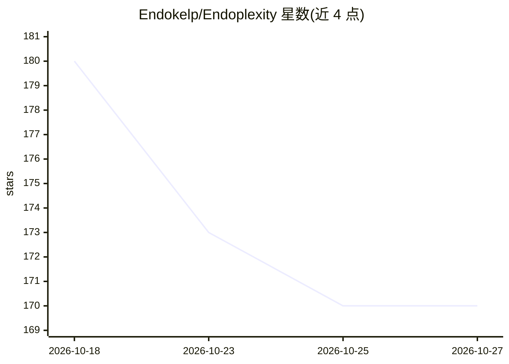

# Endokelp/Endoplexity

⭐ 170 · TypeScript · Apache-2.0 · 推送 2026-08-15 · [GitHub](https://github.com/Endokelp/Endoplexity) · 个人维护

**Chrome 侧边栏扩展：用已订阅的 Claude/Cursor CLI 驱动浏览器操作**

由 Chrome MV3 侧边栏扩展与本地 Node 桥接服务（127.0.0.1:8787）组成：面板持有 CDP 连接控制真实浏览器，桥接层经 MCP/HTTP 向本机 claude 或 cursor-agent CLI 暴露 14 个浏览器工具（点击、输入、导航、标签页等），不直连模型、无需 API key，复用用户已有订阅。页面以可访问性树快照传给模型，动作后回传页面增量；提交/删除/购买等不可逆动作经审批门拦截，提供 watch/normal/trust 三种自主模式。v0.0.1 早期阶段，Windows 优先，macOS/Linux 自动启动未实现；156 个单元测试，Apache-2.0 许可。

## 筛选速览

| 维度 | 判定 | 备注 |
|---|---|---|
| AI 角色 | `ai-native` | 本体是模型或模型工具 |
| 许可风险 | `permissive` | Apache-2.0 |
| 部署形态 | `library` | 以包/库形式分发 |
| 模型依赖 | locked-api |  |
| 硬件要求 | — | 无带数字的原话,不猜 |
| 安装摩擦 | `low` | 无编译、无系统依赖或容器化 |
| 成熟度 | `idea` | |

## 能力要点

- 经 MCP 向本机 claude/cursor-agent CLI 暴露 14 个浏览器工具，无需 API key
- 页面以可访问性树快照传递，动作返回页面并只回传变化行（token 3.8x 削减）
- 桥接层强制安全策略：回环绑定、来源锁定、审批门、三种自主模式默认 fail closed
- read_file 支持 PDF/DOCX/XLSX 等附件以文本进入模型上下文

## 适用场景

- 用自然语言让 AI 在我已登录的真实浏览器里填表、比价、跨标签页收集信息
- 复用现有 Claude/Cursor 订阅执行浏览器任务，避免按次付费 API
- 让 agent 读取页面附件并回答问题后填入表单

## 场景标签

`浏览器自动化` · 领域:效率与自动化

## 证据(README 行号)

> L7: A Chrome side panel that reads and acts on the page you're actually looking at:
> L44: whole project: a tool server and a UI. The agent loop is the CLI you already
> L92: - **The `claude` CLI, the `cursor-agent` CLI, or both**, already logged in to

## 星数曲线

2026-10-18 180 → 2026-10-27 170（-10）

---
*卡片 v1 · prompt 1.4 · 生成 2026-10-22 · 置信度 high · 依据 README sha `08e936f96c6a` · [字段定义](../../DATASET.md)*
