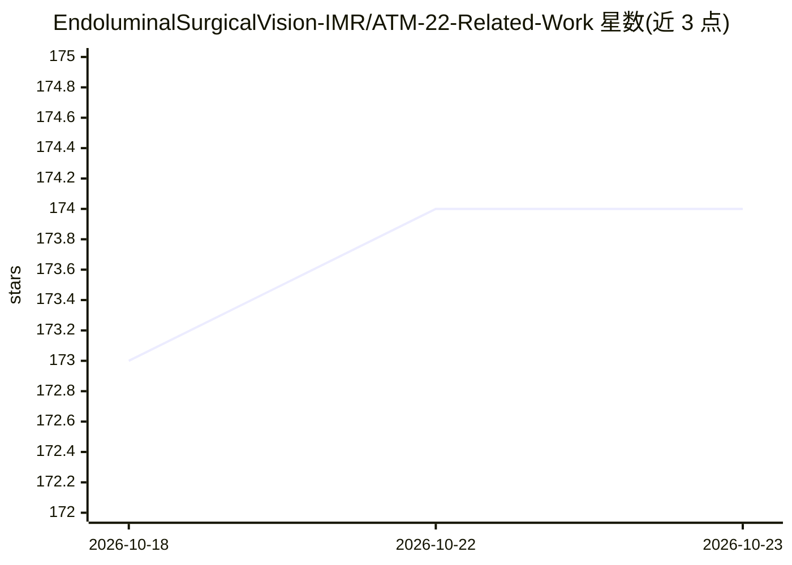

# EndoluminalSurgicalVision-IMR/ATM-22-Related-Work

⭐ 174 · Python · MIT · 推送 2026-01-15 · [GitHub](https://github.com/EndoluminalSurgicalVision-IMR/ATM-22-Related-Work) · [官网](https://atm22.grand-challenge.org/) · 组织维护 · 中文 README

**气道树建模(ATM'22)挑战赛基准与气道分割论文合集**

MICCAI 2022 Multi-site, Multi-domain Airway Tree Modeling (ATM'22) 挑战赛的官方仓库，由上海交通大学医疗机器人研究所与上海市胸科医院团队组织。内容含挑战赛注册流程、基线模型与 Docker 提交教程、评测代码引用、后续 BAS 数据集整合、隐藏测试集（150 例 CT）的长期测试阶段结果（通过邮件提交 Docker 或 API），并整理 2012-2025 年肺部气道分割与支气管镜导航相关论文表格（含会议与代码链接）。面向医学影像研究者使用。

## 筛选速览

| 维度 | 判定 | 备注 |
|---|---|---|
| AI 角色 | `ai-knowledge` | 知识聚合/清单类 |
| 许可风险 | `permissive` | MIT |
| 部署形态 | `None` |  |
| 模型依赖 | — | README 未给出锁定关系 |
| 硬件要求 | — | 无带数字的原话,不猜 |
| 安装摩擦 | `low` | 无编译、无系统依赖或容器化 |
| 成熟度 | — | 结构信号不足 |

## 能力要点

- ATM'22 官方基准仓库，含 150 例 CT 隐藏测试集长期评测通道
- 提供基线模型与 Docker 提交教程及评测代码指引
- 整理 50 余篇气道分割/支气管镜导航论文（2012-2025）及代码链接
- 整合 Binary Airway Segmentation (BAS) 数据集

## 适用场景

- 查找肺部气道分割领域的论文与开源代码
- 在 ATM'22 隐藏测试集上提交算法并获取长期评测结果
- 获取挑战赛数据集与基线模型开展气道树建模研究

## 场景标签

`模型评测` `精选清单` · 领域:评测与运维

## 证据(README 行号)

> L10: **Official repository for MICCAI 2022 Challenge:** **_Multi-site, Multi-Domain Airway Tree Modeling (ATM’22)_**.
> L45: ## Related Works

## 星数曲线

2026-10-18 173 → 2026-10-23 174（+1）

---
*卡片 v1 · prompt 1.4 · 生成 2026-10-22 · 置信度 high · 依据 README sha `dca4307055fc` · [字段定义](../../DATASET.md)*
