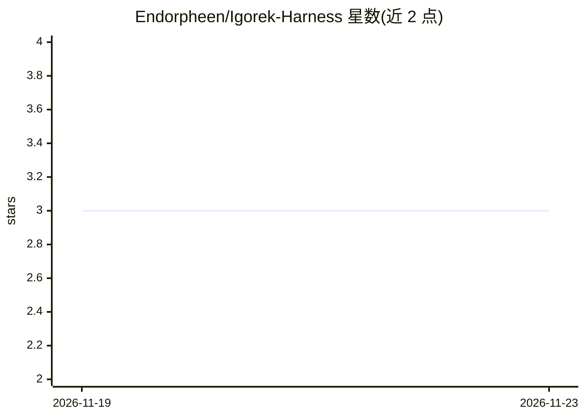

# Endorpheen/Igorek-Harness

⭐ 3 · Python · Apache-2.0 · 推送 2026-11-19 · [GitHub](https://github.com/Endorpheen/Igorek-Harness) · 个人维护 · 中文 README

**个人 AI agent 工作区：桌面、Android 与终端多端控制同一 agent**

Electron 桌面应用，将对话、文件读写、agent 工具调用、操作审批、浏览器标签页与连接配置整合在一个工作区；Android 客户端 Igorek Remote 通过 QR 配对控制同一 agent，另有 CLI/TUI、本地 Web UI、Telegram 与 ACP 接口。核心机制包括：Vault 加密凭据管理、按 profile 的权限控制、操作审批与检查点、后台定时任务执行，以及本地 llama.cpp 模型的原生工具历史支持。面向需要多端管理个人 agent 任务的开发者与终端用户。

## 筛选速览

| 维度 | 判定 | 备注 |
|---|---|---|
| AI 角色 | `ai-native` | 本体是模型或模型工具 |
| 许可风险 | `permissive` | Apache-2.0 |
| 部署形态 | `None` |  |
| 模型依赖 | — | README 未给出锁定关系 |
| 硬件要求 | — | 无带数字的原话,不猜 |
| 安装摩擦 | `low` | 无编译、无系统依赖或容器化 |
| 成熟度 | `idea` | |

## 能力要点

- 桌面、Android、CLI/TUI、Telegram、Web UI 多接口访问同一 agent 会话
- 操作审批、检查点与文件变更回滚机制
- Vault 加密凭据存储与按模型 profile 的权限管理
- 本地 llama.cpp 模型获得原生工具历史与确认身份校验

## 适用场景

- 在手机上查看和审批桌面 agent 正在执行的任务
- 让 agent 读写文件、执行命令并逐项审批操作
- 定时后台任务执行并将结果回传到会话

## 场景标签

`AI 助手` · 领域:对话与助手

## 证据(README 行号)

> L14: Igorek is an Electron desktop application for working with an AI agent:
> L45: |The model is a choice|Cloud connections and local endpoints share the interface; Vault and profiles manage credent

## 星数曲线

2026-11-19 3 → 2026-11-23 3（+0）

---
*卡片 v1 · prompt 1.4 · 生成 2026-11-22 · 置信度 high · 依据 README sha `123f3ec91f83` · [字段定义](../../DATASET.md)*
