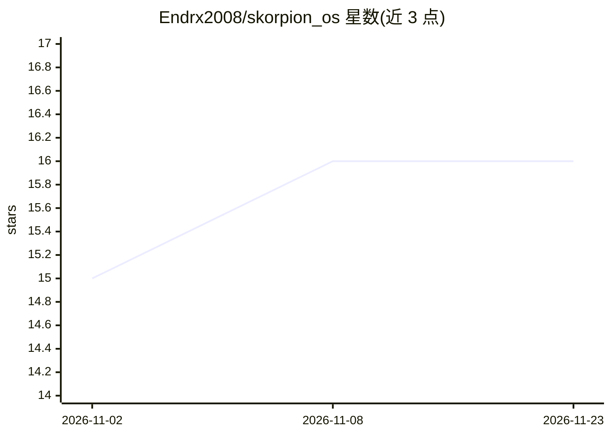

# Endrx2008/skorpion_os

⭐ 16 · NOASSERTION · 推送 2026-11-19 · [GitHub](https://github.com/Endrx2008/skorpion_os) · [官网](https://skossite.pages.dev) · 个人维护

**内置本地 AI 助手的轻量级 Linux 发行版**

基于 Debian/Arch 的开源 Linux 发行版，三个版本（Cinnamon/Lite/Mantis），系统集成由 Ollama 驱动的本地 AI 助手 SKAI，组件共享单一本地模型，无云端与账号，可通过一次点击移除 AI。配套生态含本地 AI 控制中心、笔记、自然语言文件管理器、LibreOffice/Thunderbird/Firefox 扩展等。需 x86_64 AVX2 CPU、8GB 内存（推荐模型需 16GB）、4GB VRAM；首次启动需联网下载 Ollama 与模型。GPLv3 许可。

## 筛选速览

| 维度 | 判定 | 备注 |
|---|---|---|
| AI 角色 | `ai-enhanced` | 去掉 AI 部分产品仍成立 |
| 许可风险 | `none` | NOASSERTION |
| 部署形态 | `None` |  |
| 模型依赖 | local-ok | 支持本地模型 |
| 硬件要求 | `gpu-8g` | |
| 安装摩擦 | `medium` | 含编译或系统依赖之一 |
| 成熟度 | — | 结构信号不足 |

## 能力要点

- 三个版本：Cinnamon(Debian)/Lite(Debian+i3)/Mantis(Arch+Hyprland)
- SKAI 本地 AI 助手由 Ollama 驱动，全部本地运行
- 配套 SKAI 生态：控制中心、笔记、CLI 文件管理器、办公与浏览器扩展
- AI 可一键移除

## 适用场景

- 想用带本地 AI 助手的 Linux 桌面系统
- 旧硬件上跑轻量级发行版（Lite 版 i3）
- 注重隐私、不依赖云端的本地 AI 体验

## 场景标签

`AI 助手` `知识库管理` · 领域:对话与助手

## 证据(README 行号)

> L3: **A lightweight Linux distribution with a local AI built in — your butler, not your master.**
> L9: Skorpion OS is an open source Linux distribution that ships with an integrated AI assistant, **SKAI**, powered by **
> L11: The AI works *alongside* you, not *instead of* you. It simplifies office work and everyday computing so you have mo

## 星数曲线

2026-11-02 15 → 2026-11-23 16（+1）

---
*卡片 v1 · prompt 1.4 · 生成 2026-11-18 · 置信度 high · 依据 README sha `4707d118c9eb` · [字段定义](../../DATASET.md)*
