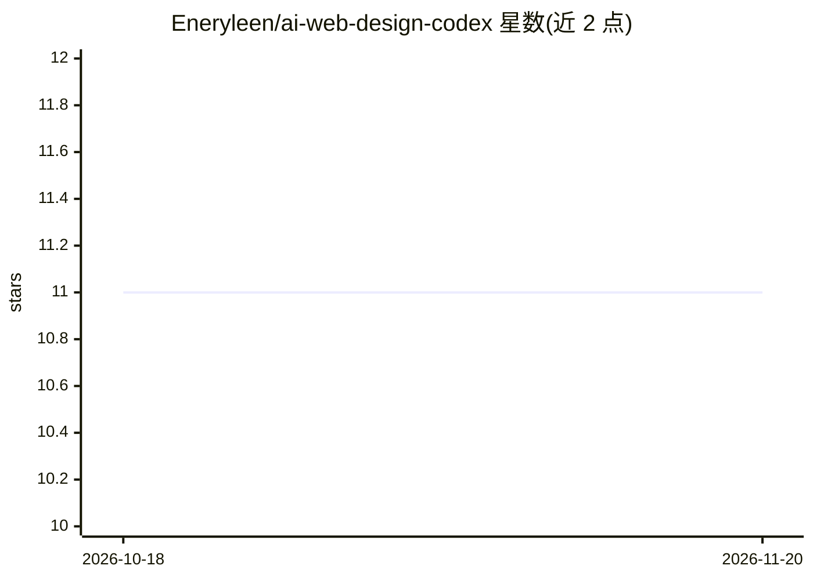

# Eneryleen/ai-web-design-codex

⭐ 11 · CC-BY-4.0 · 推送 2026-06-21 · [GitHub](https://github.com/Eneryleen/ai-web-design-codex) · 个人维护

**面向人类与 AI agent 的网页设计知识库（60 篇指南）**

一份网页设计 + UX + 营销的结构化知识库，收录 60 篇交叉链接的指南，覆盖视觉设计、UX 基础、响应式布局、站点类型、前端技术栈、营销转化、美学与反模式等 10 个板块。每篇指南遵循统一骨架（TL;DR→概念→具体规格→do/don't→陷阱→用户抱怨→清单→来源）。README 说明其双重用途：人类按主题浏览参考，LLM agent 通过 `AGENTS.md` 选择性读取以辅助设计。以 Markdown 文档形式提供，许可为 CC BY 4.0。

## 筛选速览

| 维度 | 判定 | 备注 |
|---|---|---|
| AI 角色 | `ai-knowledge` | 知识聚合/清单类 |
| 许可风险 | `viral` | CC-BY-4.0 |
| 部署形态 | `None` |  |
| 模型依赖 | — | README 未给出锁定关系 |
| 硬件要求 | — | 无带数字的原话,不猜 |
| 安装摩擦 | `low` | 无编译、无系统依赖或容器化 |
| 成熟度 | — | 结构信号不足 |

## 能力要点

- 60 篇交叉链接指南，覆盖 10 个板块（设计/UX/转化/反模式等）
- 统一文档骨架：TL;DR→规格数字→do/don't→清单→来源
- 附带 `AGENTS.md`，供 AI agent 选择性读取使用
- 覆盖 WCAG 2.2 无障碍、i18n、Core Web Vitals 等专题

## 适用场景

- 设计或评审网页时按主题查阅具体规则与规格数字
- 让 AI agent 在生成/评审网页设计时读取相关知识
- 构建落地页、后台仪表盘等特定站点类型时按 playbook 操作

## 场景标签

`教程课程` · 领域:学习与行业

## 证据(README 行号)

> L3: > A senior-level knowledge base for designing and building **beautiful, usable, accessible, high-converting** websit
> L19: - **For AI agents** — a knowledge base an LLM reads *selectively* to design at a senior level. See How to use this 

## 星数曲线

2026-10-18 11 → 2026-11-20 11（+0）

---
*卡片 v1 · prompt 1.4 · 生成 2026-11-19 · 置信度 high · 依据 README sha `09578942c651` · [字段定义](../../DATASET.md)*
