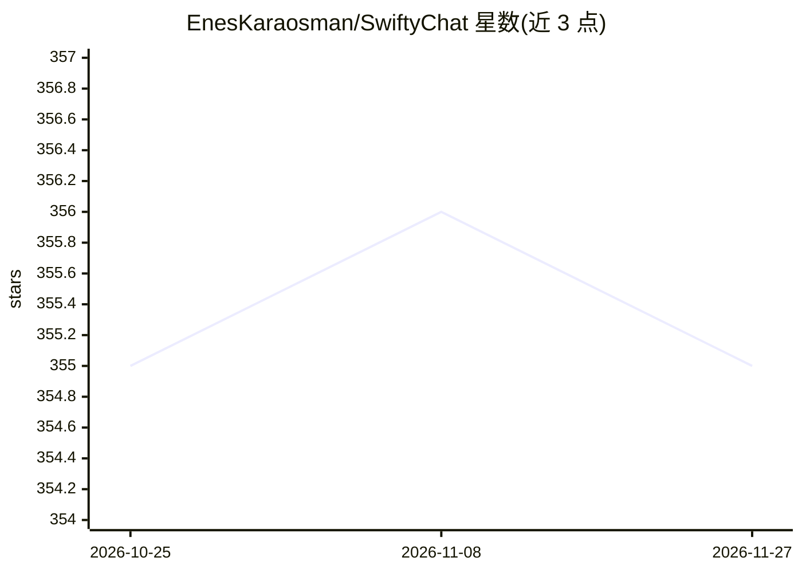

# EnesKaraosman/SwiftyChat

⭐ 355 · Swift · Apache-2.0 · 推送 2026-11-16 · [GitHub](https://github.com/EnesKaraosman/SwiftyChat) · [官网](https://swiftpackageindex.com/EnesKaraosman/SwiftyChat) · 个人维护

**给 iOS/macOS 开发者的 SwiftUI 聊天界面组件库**

SwiftyChat 是一个 SwiftUI 聊天 UI 框架，提供 11 种内置消息类型（文本、图片、视频、位置、轮播、快速回复、链接预览等）、5 个演示主题与通过 SwiftUI environment 注入的样式定制。支持 iOS 17+ 与 macOS 14+ 单一代码库，内置 BasicInputView 输入栏、未读消息指示、回复引用导航、失败重试、链接预览辅助类。消息渲染为懒加载，唯一包依赖为 Kingfisher。README 将轮播、快速回复、加载指示等组件定位为适配聊天机器人界面，应用自行实现 AI 逻辑。

## 筛选速览

| 维度 | 判定 | 备注 |
|---|---|---|
| AI 角色 | `ai-enhanced` | 去掉 AI 部分产品仍成立 |
| 许可风险 | `permissive` | Apache-2.0 |
| 部署形态 | `None` |  |
| 模型依赖 | — | README 未给出锁定关系 |
| 硬件要求 | — | 无带数字的原话,不猜 |
| 安装摩擦 | `low` | 无编译、无系统依赖或容器化 |
| 成熟度 | — | 结构信号不足 |

## 能力要点

- 11 种内置消息类型与自定义消息 cell
- 通过 ChatMessageCellStyle 与 environment 全量样式定制，支持浅色/深色外观
- 未读指示、回复引用导航、失败重试、分页与流式回复等会话功能
- 快速回复、轮播、加载指示组件面向机器人对话界面

## 适用场景

- 为我的聊天机器人 App 搭建 SwiftUI 聊天界面
- 开发客服消息应用并自定义消息气泡样式
- 在 iOS 和 macOS 用同一套代码渲染对话 UI

## 场景标签

 · 领域:移动开发/用户界面组件

## 证据(README 行号)

> L3:  A lightweight, cross-platform SwiftUI chat UI framework. Perfect for AI chatbots, customer support, and messaging a
> L189: Building a ChatGPT-style app, a customer support bot, or an in-app assistant? SwiftyChat gives you the UI layer so

## 星数曲线

2026-10-25 355 → 2026-11-27 355（+0）

---
*卡片 v1 · prompt 1.4 · 生成 2026-11-25 · 置信度 high · 依据 README sha `eedda601fb98` · [字段定义](../../DATASET.md)*
