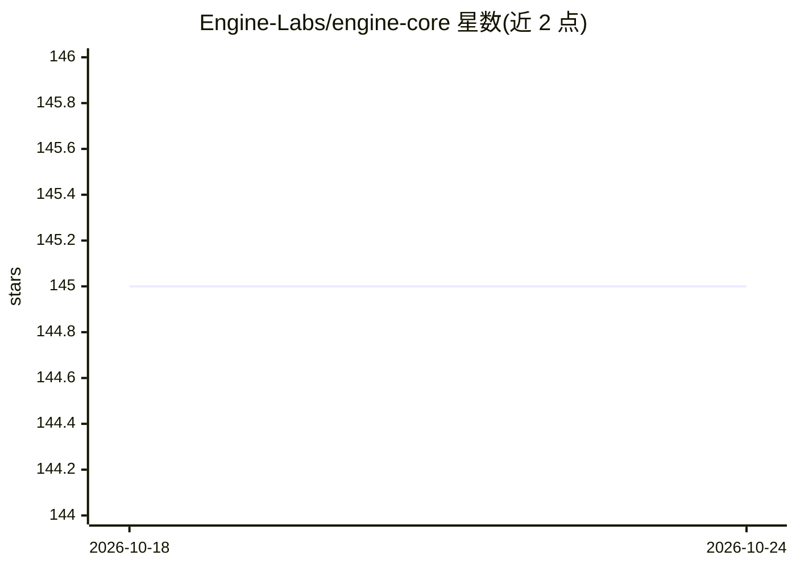

# Engine-Labs/engine-core

⭐ 145 · TypeScript · Apache-2.0 · 推送 2026-01-16 · [GitHub](https://github.com/Engine-Labs/engine-core) · [官网](https://www.enginelabs.ai) · 组织维护

**面向软件工程任务的 LLM 聊天策略工具：可换模型的自研工程师**

Engine 是一个开源的 LLM 驱动软件工程师命令行工具，模型无关、可扩展，架构基于 strategies 与 adapters 两层：策略在每次运行时动态调整上下文、系统提示与可用工具以适配具体工程任务；适配器使 GPT、Claude 等基础模型可热切换。项目内含 3 个示例策略（demo 起步示例、在本地 Fastify 应用上做数据库迁移与 API 端点的 backendStrategy、可写文件并运行进程的 shellStrategy）。通过 Docker 运行，需提供 OpenAI 或 Anthropic API key。

## 筛选速览

| 维度 | 判定 | 备注 |
|---|---|---|
| AI 角色 | `ai-native` | 本体是模型或模型工具 |
| 许可风险 | `permissive` | Apache-2.0 |
| 部署形态 | `None` |  |
| 模型依赖 | — | README 未给出锁定关系 |
| 硬件要求 | — | 无带数字的原话,不猜 |
| 安装摩擦 | `low` | 无编译、无系统依赖或容器化 |
| 成熟度 | — | 结构信号不足 |

## 能力要点

- strategies/adapters 双层架构，基础模型（GPT、Claude）可热切换
- 策略在每次运行动态调整上下文、系统提示与可用工具
- 内含 3 个示例策略：demo、Fastify 后端开发、LLM shell

## 适用场景

- 用 LLM 在本地 Fastify 应用上生成数据库迁移与 API 端点
- 通过 LLM shell 让模型写文件并运行进程
- 以示例策略为起点定制特定工程任务的策略

## 场景标签

`编码 Agent` · 领域:编码与开发

## 证据(README 行号)

> L3: Engine is an open source software engineer.
> L5: It is model agnostic and extensible, based on 'strategies' and 'adapters'.

## 星数曲线

2026-10-18 145 → 2026-10-24 145（+0）

---
*卡片 v1 · prompt 1.4 · 生成 2026-10-22 · 置信度 high · 依据 README sha `d118748436e1` · [字段定义](../../DATASET.md)*
