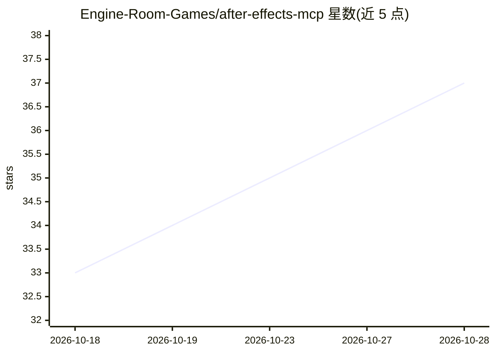

# Engine-Room-Games/after-effects-mcp

⭐ 38 · JavaScript · MIT · 推送 2026-10-25 · [GitHub](https://github.com/Engine-Room-Games/after-effects-mcp) · [官网](https://www.npmjs.com/package/@engine-room/after-effects-mcp) · 组织维护

**用 AI 控制Adobe After Effects的 MCP 服务器**

面向动效制作者的 MCP 服务器：将 After Effects 暴露给 Claude、Cursor、VS Code 等 MCP 客户端，用户以自然语言描述想要的动画，AI 通过 76 个工具在项目中创建图层、关键frame、缓动、效果、表达式与文本，产物均为普通可编辑的 AE 工程。需 After Effects 2026（macOS/Windows）并安装配套 AE 面板；支持从已有 comp 读取风格生成 house-style.md，后续构建遵循该风格。提供 .mcpb 一键安装、npx、独立可执行文件与 Claude Code 插件四种接入方式。

## 筛选速览

| 维度 | 判定 | 备注 |
|---|---|---|
| AI 角色 | `ai-ecosystem` | LLM/agent 周边工具 |
| 许可风险 | `permissive` | MIT |
| 部署形态 | `library` | 以包/库形式分发 |
| 模型依赖 | — | README 未给出锁定关系 |
| 硬件要求 | — | 无带数字的原话,不猜 |
| 安装摩擦 | `low` | 无编译、无系统依赖或容器化 |
| 成熟度 | — | 结构信号不足 |

## 能力要点

- 76 个工具覆盖合成、图层、关键frame、效果、表达式、遮罩、音频等
- run_batch 最多 500 步操作合并为一次撤销
- 从已有 comp 提取 house-style.md 风格指南并持久遵循
- run_jsx 可执行任意 ExtendScript 以覆盖其余工具未涉及的操作

## 适用场景

- 用自然语言生成下三分之一字幕、logo 动画、数据图等动效
- 让 AI 按团队既有视觉风格批量产出季度报告类动画序列
- 通过截图工具让 AI 自查所生成动画的效果

## 场景标签

 · 领域:创意软件/动效制作自动化

## 证据(README 行号)

> L16: Works with **Claude**, **Cursor**, **VS Code**, **Codex**, **Windsurf** and any other MCP client.
> L104: > Set up After Effects.
> L162: |Comps (10)|`list_comps`, `get_comp`, `get_comp_tree`, `create_comp`, `set_comp`, `delete_comp`, `set_active_comp`

## 星数曲线

2026-10-18 33 → 2026-10-28 37（+4）

---
*卡片 v1 · prompt 1.4 · 生成 2026-10-25 · 置信度 high · 依据 README sha `fc10083e6d2a` · [字段定义](../../DATASET.md)*
