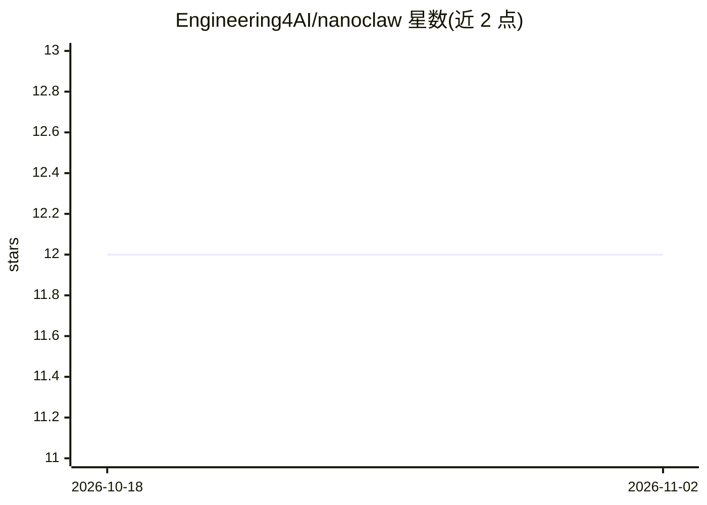

# Engineering4AI/nanoclaw

⭐ 12 · TypeScript · 推送 2026-06-02 · [GitHub](https://github.com/Engineering4AI/nanoclaw) · 组织维护

**极简个人 AI 助手：约 2000 行 TS 的聊天平台 agent 网关**

以 Bun + TypeScript 实现的个人 AI 助手网关，连接 Telegram、Slack、Discord 三个聊天平台，通过流式工具调用循环执行文件读写、Shell、网页抓取/搜索等内核工具。模型接入支持 OpenRouter、Anthropic、OpenAI 及 OpenAI 兼容端点与本地 Ollama；配置集中在一个 .env 文件。持久记忆仅靠 AGENTS.md/USER.md 两个文件，无语音、子代理、技能市场等功能；每次运行为独立 OS 进程，JSONL + SQLite 支持崩溃恢复。

## 筛选速览

| 维度 | 判定 | 备注 |
|---|---|---|
| AI 角色 | `ai-native` | 本体是模型或模型工具 |
| 许可风险 | `none` | — |
| 部署形态 | `library` | 以包/库形式分发 |
| 模型依赖 | local-ok | 支持本地模型 |
| 硬件要求 | — | 无带数字的原话,不猜 |
| 安装摩擦 | `low` | 无编译、无系统依赖或容器化 |
| 成熟度 | — | 结构信号不足 |

## 能力要点

- 约 2000 行 TypeScript 的 agent 循环与流式工具调用
- 接入 Telegram/Slack/Discord 三平台
- 支持 OpenRouter/Anthropic/OpenAI/Ollama 等多种模型来源
- 单 .env 配置，JSONL+SQLite 崩溃恢复

## 适用场景

- 在 Telegram/Slack/Discord 里让 AI 替我读日志、跑命令、查网页
- 自托管一个可阅读源码、便于改造的个人助手
- 本地 Ollama 搭配使用的轻量 agent 网关

## 场景标签

`AI 助手` `Agent 框架` · 领域:Agent 开发

## 证据(README 行号)

> L11: User: "summarize the errors in app.log from the last 10 minutes"
> L12: Bot:  [reads file] [runs grep] → "Found 3 ERROR lines: connection timeout (×2), OOM at 14:32"
> L141:   main.ts                      # entry point — reads env, starts gateway

## 星数曲线

2026-10-18 12 → 2026-11-02 12（+0）

---
*卡片 v1 · prompt 1.4 · 生成 2026-11-01 · 置信度 mid · 依据 README sha `f5061cde40f1` · [字段定义](../../DATASET.md)*
