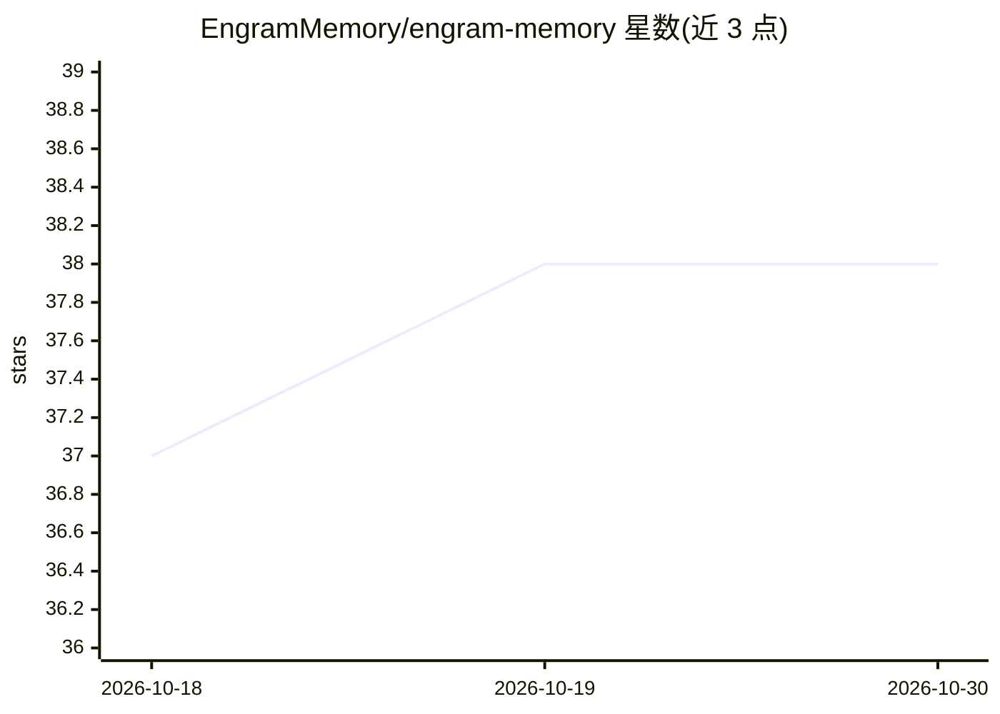

# EngramMemory/engram-memory

⭐ 38 · Python · NOASSERTION · 推送 2026-06-01 · [GitHub](https://github.com/EngramMemory/engram-memory) · [官网](https://engrammemory.ai) · 组织维护

**自托管的 AI agent 持久记忆系统（MCP 服务，三层检索）**

为 AI agent 提供跨会话持久记忆的自托管服务：单个 Docker 容器打包 Qdrant、FastEmbed（ONNX 嵌入）与 MCP server，提供 15 个 MCP 工具覆盖记忆存取、搜索、遗忘、合并、冲突检测与时间线浏览，支持 13 类记忆的本地关键词自动分类。检索采用三层架构：ACT-R 激活缓存、LSH 多头哈希索引、Qdrant 向量+BM25 混合重排，另含 Kuzu 实体图。面向 Claude Code、Cursor 等 MCP 客户端，本地运行无 API key；Community 版对缓存条目、图规模等设有限制，Cloud 版提供扩展能力。

## 筛选速览

| 维度 | 判定 | 备注 |
|---|---|---|
| AI 角色 | `ai-ecosystem` | LLM/agent 周边工具 |
| 许可风险 | `none` | NOASSERTION |
| 部署形态 | `self-host` | docker 或自建部署 |
| 模型依赖 | — | README 未给出锁定关系 |
| 硬件要求 | — | 无带数字的原话,不猜 |
| 安装摩擦 | `low` | 无编译、无系统依赖或容器化 |
| 成熟度 | — | 结构信号不足 |

## 能力要点

- 三层检索：ACT-R 激活缓存 + 多头 LSH 索引 + Qdrant 向量与 BM25 混合重排
- 单个 Docker 容器打包 Qdrant/FastEmbed/MCP server，本地运行无 API key
- 15 个 MCP 工具 + 13 类记忆本地自动分类 + 冲突检测与时间线查询
- 提供 HTTP/SSE/Stdio/REST 四种接入方式

## 适用场景

- 让 Claude Code、Cursor 等编程 agent 记住我的偏好与项目决策
- 多设备通过 hive 共享记忆池
- 对记忆按时间范围回溯与去重整理

## 场景标签

`Agent 记忆` · 领域:Agent 开发

## 证据(README 行号)

> L12: Engram gives your AI agent persistent memory across sessions. Store, search, recall, and forget memories using sema
> L14: One container bundles **Qdrant**, **FastEmbed**, and the **MCP server**. One command to install. Works with Claude 
> L145: The container exposes four transports off the same recall engine:

## 星数曲线

2026-10-18 37 → 2026-10-30 38（+1）

---
*卡片 v1 · prompt 1.4 · 生成 2026-10-25 · 置信度 mid · 依据 README sha `d1e8a9d9189d` · [字段定义](../../DATASET.md)*
