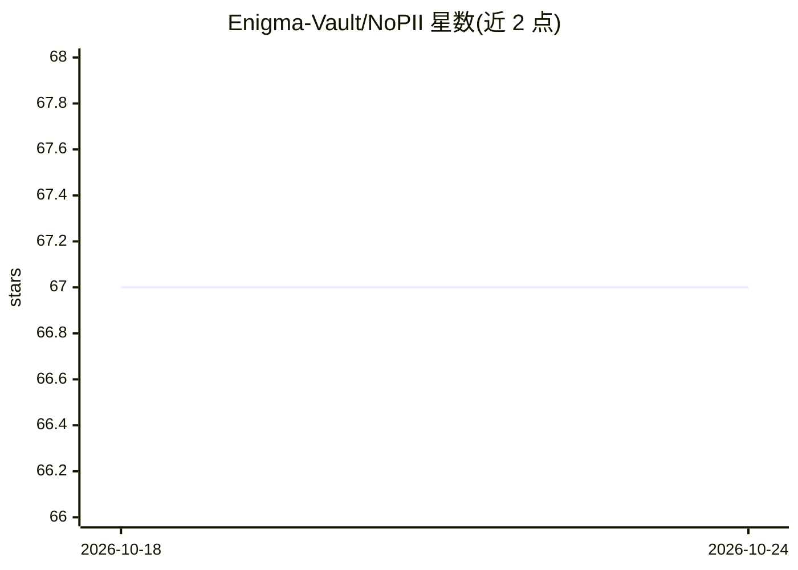

# Enigma-Vault/NoPII

⭐ 67 · Python · MIT · 推送 2026-05-18 · [GitHub](https://github.com/Enigma-Vault/NoPII) · 组织维护

**LLM API 前的 PII 令牌化反向代理：检测并替换敏感数据**

NoPII 是位于应用与 LLM 服务商之间的反向代理：检测出站请求中的 PII（姓名、SSN、邮箱、电话、信用卡号等），替换为确定性令牌，并在响应中还原原值，使 LLM 不接触真实数据。应用仅需改 base_url 一行即可接入；同一 PII 在账户内始终生成同一令牌，支持多轮对话实体一致性。无法令牌化的请求会被阻断（fail-safe）。限制：仅处理文本，模糊/语义检索与对 PII 值直接操作的场景不适用；为商业产品，免费层每月含 100 万受保护令牌。本仓库为 MIT 许可的接入示例集合。

## 筛选速览

| 维度 | 判定 | 备注 |
|---|---|---|
| AI 角色 | `ai-ecosystem` | LLM/agent 周边工具 |
| 许可风险 | `permissive` | MIT |
| 部署形态 | `library` | 以包/库形式分发 |
| 模型依赖 | — | README 未给出锁定关系 |
| 硬件要求 | — | 无带数字的原话,不猜 |
| 安装摩擦 | `low` | 无编译、无系统依赖或容器化 |
| 成熟度 | — | 结构信号不足 |

## 能力要点

- 出站请求 PII 检测与确定性令牌替换，响应中自动还原
- 应用仅改 base_url 一行接入，无需中间件
- fail-safe：无法令牌化的请求直接阻断，PII 不外泄
- 支持流式、多轮、工具调用、JSON 模式等场景

## 适用场景

- 我的应用要调用 LLM 处理含客户敏感数据的请求
- 多轮对话中保持同一实体令牌一致以维持上下文
- 审计 PII 检测记录（实体类型、置信度、时间戳）

## 场景标签

`网络安全` · 领域:学习与行业

## 证据(README 行号)

> L5: NoPII is a PII-tokenizing reverse proxy for LLM APIs. It sits between your application and your LLM provider, detect
> L145: |Chat completions|**Supported**|OpenAI, Anthropic, DeepSeek, Gemini, and other OpenAI-compatible APIs|

## 星数曲线

2026-10-18 67 → 2026-10-24 67（+0）

---
*卡片 v1 · prompt 1.4 · 生成 2026-10-24 · 置信度 mid · 依据 README sha `f3a393fcda99` · [字段定义](../../DATASET.md)*
