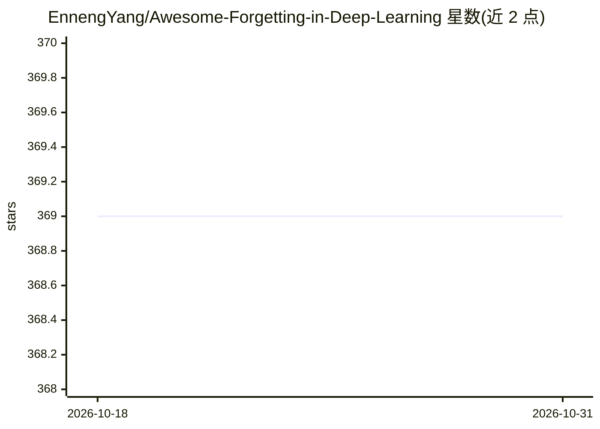

# EnnengYang/Awesome-Forgetting-in-Deep-Learning

⭐ 369 · 推送 2026-01-27 · [GitHub](https://github.com/EnnengYang/Awesome-Forgetting-in-Deep-Learning) · [官网](https://arxiv.org/abs/2307.09218) · 个人维护

**深度学习中遗忘现象的论文综述清单（TPAMI 2024）**

配套 TPAMI 2024 综述论文 'A Comprehensive Survey of Forgetting in Deep Learning Beyond Continual Learning' 的论文列表仓库。将遗忘现象划分为有害遗忘与有益遗忘两大框架，按持续学习、基础模型、域适应、元学习、生成模型、强化学习、联邦学习等研究领域组织论文条目，每个领域下再按方法分支（如基于记忆回放、正则化、贝叶斯等）细分，条目含论文标题、年份与发表会议/期刊。面向机器学习研究者，提供引用条目（BibTeX）。

## 筛选速览

| 维度 | 判定 | 备注 |
|---|---|---|
| AI 角色 | `ai-knowledge` | 知识聚合/清单类 |
| 许可风险 | `none` | — |
| 部署形态 | `None` |  |
| 模型依赖 | — | README 未给出锁定关系 |
| 硬件要求 | — | 无带数字的原话,不猜 |
| 安装摩擦 | `low` | 无编译、无系统依赖或容器化 |
| 成熟度 | — | 结构信号不足 |

## 能力要点

- 覆盖持续学习之外 8 个研究领域的遗忘问题分类框架
- 区分有害遗忘与有益遗忘（如隐私保护场景）
- 条目含论文标题、年份与会议/期刊信息
- 按方法分支（Memory/Regularization/Bayesian 等）细分条目

## 适用场景

- 查找特定领域（联邦学习/生成模型等）中遗忘相关论文
- 按方法分支检索持续学习论文
- 综述写作时追溯遗忘研究的分类体系

## 场景标签

`精选清单` · 领域:学习与行业

## 证据(README 行号)

> L5: A comprehensive list of papers about **'A Comprehensive Survey of Forgetting in Deep Learning Beyond Continual Learn
> L25: ## Harmful Forgetting

## 星数曲线

2026-10-18 369 → 2026-10-31 369（+0）

---
*卡片 v1 · prompt 1.4 · 生成 2026-10-21 · 置信度 high · 依据 README sha `376633b58249` · [字段定义](../../DATASET.md)*
