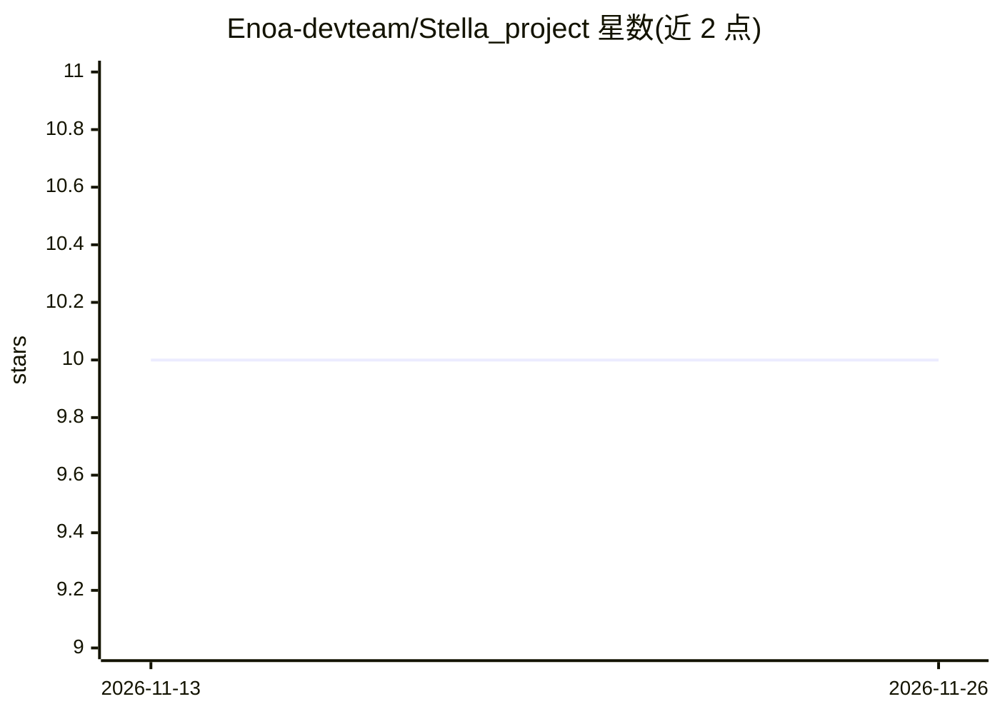

# Enoa-devteam/Stella_project

⭐ 10 · Python · NOASSERTION · 推送 2026-11-25 · [GitHub](https://github.com/Enoa-devteam/Stella_project) · [官网](https://enoa-devteam.github.io/Stella_project-homepage/) · 组织维护 · 中文 README

**QQ 群聊拟人化聊天机器人：8K 上下文下的记忆系统**

基于 NoneBot2 + OneBot V11/V12 的 QQ 群聊机器人，围绕 8192 token 的小上下文窗口设计：记忆在库中过滤后注入、工具在聊天上下文之外执行、滚出窗口的对话自动压缩为回顾。提供两层记忆过滤（宽松捕获/严格晋升）、混合检索（SQLite FTS5 + 可选本地 embedding）、多群共享空间与记忆生命周期归档。支持全本地/全在线/混合三种模型部署方式，各角色可分别指定端点。兼容 AstrBot 插件，提供 Windows 安装与 Docker 部署途径。

## 筛选速览

| 维度 | 判定 | 备注 |
|---|---|---|
| AI 角色 | `ai-native` | 本体是模型或模型工具 |
| 许可风险 | `none` | NOASSERTION |
| 部署形态 | `None` |  |
| 模型依赖 | — | README 未给出锁定关系 |
| 硬件要求 | — | 无带数字的原话,不猜 |
| 安装摩擦 | `low` | 无编译、无系统依赖或容器化 |
| 成熟度 | — | 结构信号不足 |

## 能力要点

- 8192 token 预算拆分：记忆筛选注入、上下文外执行工具、三层上下文压缩
- 两层记忆过滤：宽松捕获 + 严格晋升（置信度分档、交叉验证、每用户配额）
- 七个模型角色可各自指定本地/在线端点，混合部署
- 兼容 AstrBot 插件，本地 Chromium 渲染插件卡片

## 适用场景

- 在 QQ 群里跑一个能记住成员信息并主动搭话的聊天机器人
- 数据不出网，用本地小模型完成群聊、记忆整理与压缩
- 为小上下文窗口的本地模型设计低预算 prompt 架构
- 多群共享用户画像与长期记忆的同时按群隔离会话

## 场景标签

`聊天机器人` `Agent 记忆` · 领域:Agent 开发

## 证据(README 行号)

> L5: **一个依托记忆系统进行拟人化聊天的 QQ 群聊机器人**
> L22: Stella 的设计前提是上下文窗口很小 —— 基准上限是 **8192 tokens**。人格、记忆、历史对话、工具结果要在这么小的预算里共存，靠堆 prompt 是不可能的。所以这个预算被拆开了：记忆在库里筛完才注入，工具在聊
> L26: - **全在线**：填一个 OpenAI 兼容的 API 就能跑，不需要显卡。

## 星数曲线

2026-11-13 10 → 2026-11-26 10（+0）

---
*卡片 v1 · prompt 1.4 · 生成 2026-11-26 · 置信度 high · 依据 README sha `3fbb5e4c0bad` · [字段定义](../../DATASET.md)*
