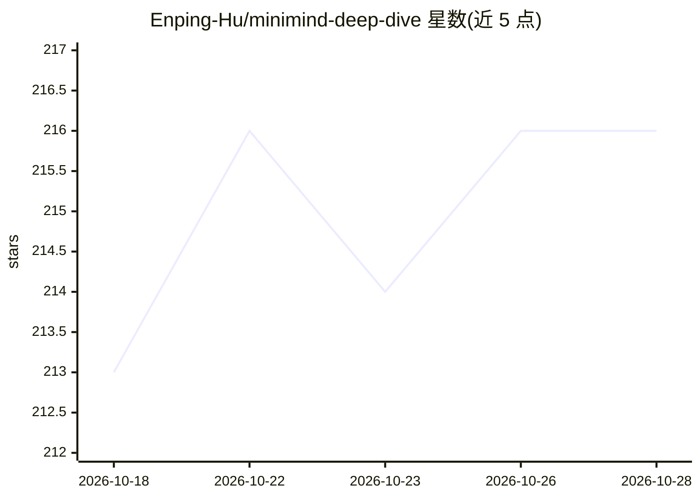

# Enping-Hu/minimind-deep-dive

⭐ 216 · Python · CC-BY-4.0 · 推送 2026-10-21 · [GitHub](https://github.com/Enping-Hu/minimind-deep-dive) · 个人维护 · 中文 README

**逐行精读 MiniMind 源码并延伸到大模型技术体系的中文学习笔记**

以 MiniMind2（约 26M 参数）为主线逐节对照源码的中文学习笔记：每节指向对应源码文件与函数/类名，覆盖预训练、推理、SFT、DPO、PPO、GRPO 与统一训练数学链，含 MiniMind2 与 MiniMind-3/Qwen3-style 逐条 diff 与第 10 章真实服务器训练实验。附录 17 篇深入卷覆盖量化、投机解码、RLHF 全景等源码未涉及主题。面向想从源码层面理解 LLM 全流程的读者，要求先了解交叉熵、self-attention、RoPE 等基础。声明主线已完稿、实验与附录持续补充。

## 筛选速览

| 维度 | 判定 | 备注 |
|---|---|---|
| AI 角色 | `ai-knowledge` | 知识聚合/清单类 |
| 许可风险 | `viral` | CC-BY-4.0 |
| 部署形态 | `None` |  |
| 模型依赖 | — | README 未给出锁定关系 |
| 硬件要求 | — | 无带数字的原话,不猜 |
| 安装摩擦 | `low` | 无编译、无系统依赖或容器化 |
| 成熟度 | — | 结构信号不足 |

## 能力要点

- 每节标注对应源码文件与符号，逐行对照 MiniMind2 主线精读
- 统一训练数学链贯穿 Pretrain/SFT/DPO/PPO/GRPO 六种训练
- MiniMind2 → MiniMind-3 / Qwen3-style 逐条源码 diff（第 9 章）
- 附录 17 篇覆盖量化、投机解码、RLHF 全景、模型代际史等主题

## 适用场景

- 对照 MiniMind 源码系统学习 LLM 预训练与对齐全流程
- 了解 MiniMind-3 相对 MiniMind2 的版本演进差异
- 通过真实训练曲线与评测数据理解 RL 训练行为

## 场景标签

`教程课程` · 领域:学习与行业

## 证据(README 行号)

> L7: 这份笔记带你**逐节对照 MiniMind 源码来读**：每节都指向对应的源码文件和符号（函数 / 类名），讲清那段代码在做什么、为什么这么写，建议并排打开 MiniMind 一起看。符号引用以 MiniMind2 主线为准，版本差
> L9: 但 MiniMind 是入口，不是终点。读懂一个组件后，笔记会从它出发延伸到所属的技术脉络——例如从 RMSNorm 讲到归一化的演进，从 CISPO 讲到 GRPO 变体家族——帮你顺着具体实现建立对大模型技术体系的理解，而不是停

## 星数曲线

2026-10-18 213 → 2026-10-28 216（+3）

---
*卡片 v1 · prompt 1.4 · 生成 2026-10-22 · 置信度 high · 依据 README sha `e1916c3d03c5` · [字段定义](../../DATASET.md)*
