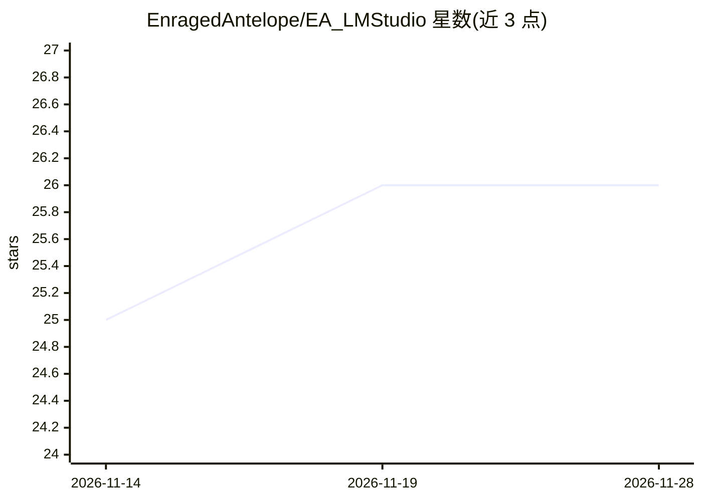

# EnragedAntelope/EA_LMStudio

⭐ 26 · Python · MIT · 推送 2026-11-24 · [GitHub](https://github.com/EnragedAntelope/EA_LMStudio) · 个人维护

**ComfyUI 节点：经 LM Studio 调用本地 LLM/VLM 生成提示词与图像描述**

一个 ComfyUI 自定义节点，通过本地运行的 LM Studio 服务器调用本地 LLM 与视觉模型，提供提示词增强、图像描述生成、推理内容抽取、JSON Schema 约束的结构化输出，以及可取消的流式生成与推理统计（tokens/sec、首 token 时间等）。内置 VRAM 管理，生成后自动卸载模型。依赖 LM Studio 本地服务器（需先启动）与 lmstudio Python SDK（1.5+），Python 3.11+。支持自定义服务器地址与 API token 认证。

## 筛选速览

| 维度 | 判定 | 备注 |
|---|---|---|
| AI 角色 | `ai-ecosystem` | LLM/agent 周边工具 |
| 许可风险 | `permissive` | MIT |
| 部署形态 | `library` | 以包/库形式分发 |
| 模型依赖 | — | README 未给出锁定关系 |
| 硬件要求 | — | 无带数字的原话,不猜 |
| 安装摩擦 | `low` | 无编译、无系统依赖或容器化 |
| 成熟度 | — | 结构信号不足 |

## 能力要点

- 自动从 LM Studio 发现模型，支持多图像（最多 4 张）视觉输入
- JSON Schema 约束解码，输出可被下游节点直接解析
- 推理内容抽取：优先用 LM Studio 的 Reasoning Parsing，否则回退标签检测
- VRAM 自动卸载与参数有效性诊断（对照 LM Studio 回报的配置）

## 适用场景

- 在 ComfyUI 工作流中把短句增强为完整的文生图提示词
- 用本地视觉模型给图片生成符合 JSON Schema 的描述供下游节点使用
- 需要本地离线运行 LLM、不依赖云端 API 的 ComfyUI 用户

## 场景标签

`提示工程` `图像生成` `多模态` · 领域:Agent 开发

## 证据(README 行号)

> L1: # EA_LMStudio
> L3:  The most fully-featured LM Studio integration for ComfyUI — auto model discovery, multi-image vision, reasoning ext
> L39: - **LM Studio** with the local server enabled. Validated against **LM Studio 0.4.19**.

## 星数曲线

2026-11-14 25 → 2026-11-28 26（+1）

---
*卡片 v1 · prompt 1.4 · 生成 2026-11-18 · 置信度 high · 依据 README sha `b487776decec` · [字段定义](../../DATASET.md)*
