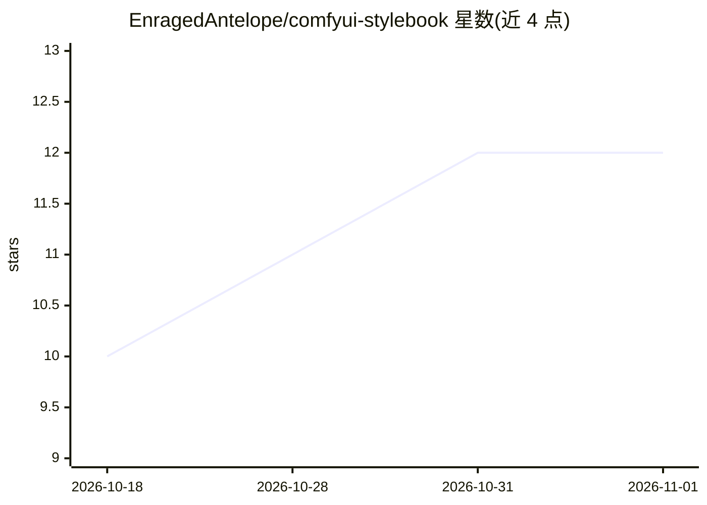

# EnragedAntelope/comfyui-stylebook

⭐ 12 · Python · MIT · 推送 2026-10-21 · [GitHub](https://github.com/EnragedAntelope/comfyui-stylebook) · [官网](https://enragedantelope.github.io/comfyui-stylebook/docs/gallery/) · 个人维护

**ComfyUI 风格/艺术家/修饰词提示词节点包，含预览图库**

ComfyUI 自定义节点包，提供 700+ 视觉风格（每个含描述、关键词、负向提示与渲染预览图）、1050+ 艺术家（各带文字描述符）与 140+ 修饰词（光照/色彩/年代/服装/质感/情绪）。提供 Style、Artist、Modifier、Blend、Sheet 五个节点，输出正向与负向提示词接入 CLIPTextEncode。支持 Pick/Random/Cycle 模式、浏览器内图库浏览、tag 过滤与别名搜索，通过 ComfyUI Manager 或 git clone 安装。离线运行，无依赖、无网络调用、无 API key。

## 筛选速览

| 维度 | 判定 | 备注 |
|---|---|---|
| AI 角色 | `ai-ecosystem` | LLM/agent 周边工具 |
| 许可风险 | `permissive` | MIT |
| 部署形态 | `None` |  |
| 模型依赖 | — | README 未给出锁定关系 |
| 硬件要求 | — | 无带数字的原话,不猜 |
| 安装摩擦 | `low` | 无编译、无系统依赖或容器化 |
| 成熟度 | — | 结构信号不足 |

## 能力要点

- 700+ 风格各带渲染预览图、关键词与手写负向提示
- 1050+ 艺术家各带文字描述符，模型不识名字时可用 Descriptor only 模式
- 五个节点：Style/Artist/Modifier/Blend/Sheet，支持 Pick/Random/Cycle 与种子可复现随机
- 浏览器内图库支持 New in x.y.z 标签、A-Z/最新排序与过滤

## 适用场景

- 生成图像前先在图库预览并选定风格再提交渲染
- 用 Sheet 节点一次把同一主体扫过多个风格出对比图
- 叠加艺术家与光照/年代修饰词精细控制出图方向

## 场景标签

`提示工程` `图像生成` · 领域:Agent 开发

## 证据(README 行号)

> L3: **700+ visual styles for ComfyUI, every one with a rendered preview you can
> L38: ```bash

## 星数曲线



2026-10-18 10 → 2026-11-01 12（+2）


---
*卡片 v1 · prompt 1.4 · 生成 2026-11-01 · 置信度 high · 依据 README sha `4e5fde41db48` · [字段定义](../../DATASET.md)*
