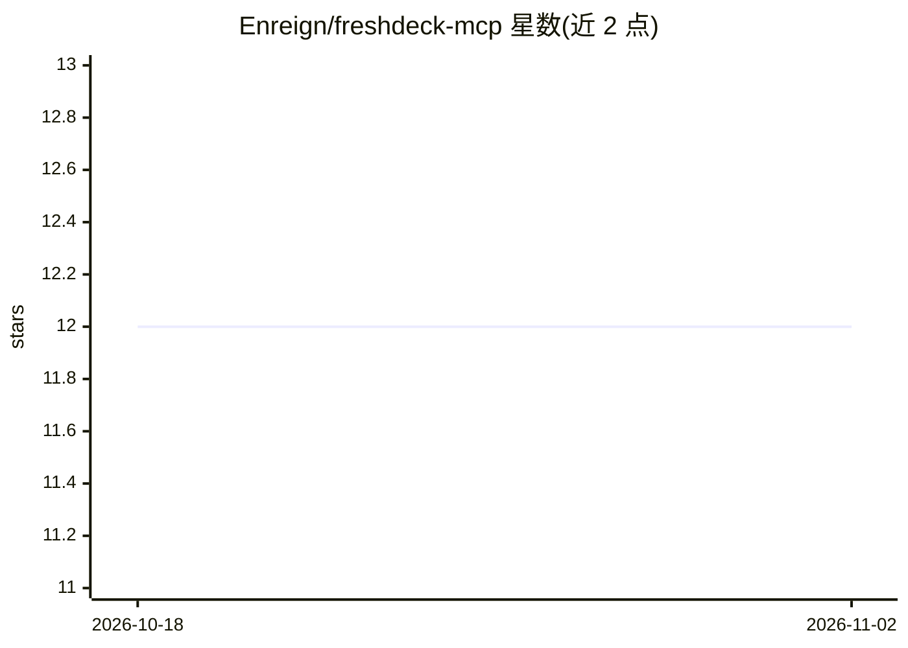

# Enreign/freshdeck-mcp

⭐ 12 · TypeScript · 推送 2026-10-21 · [GitHub](https://github.com/Enreign/freshdeck-mcp) · 个人维护

**接入 Freshdesk API v2 的 MCP 服务器，供 AI 客户端管理工单等资源**

基于 TypeScript 的 Model Context Protocol 服务器实现，封装 Freshdesk API v2，通过 MCP 接口向 AI 客户端暴露 tickets_manage、contacts_manage、agents_manage、companies_manage、conversations_manage 五个工具，覆盖工单、联系人、客服、公司与会话的增删改查搜索。内置 API key 认证与输入校验、速率限制自动节流、指数退避重试与结构化日志（Pino）。使用需配置 FRESHDESK_DOMAIN 与 FRESHDESK_API_KEY 环境变量。

## 筛选速览

| 维度 | 判定 | 备注 |
|---|---|---|
| AI 角色 | `ai-ecosystem` | LLM/agent 周边工具 |
| 许可风险 | `none` | — |
| 部署形态 | `library` | 以包/库形式分发 |
| 模型依赖 | — | README 未给出锁定关系 |
| 硬件要求 | — | 无带数字的原话,不猜 |
| 安装摩擦 | `low` | 无编译、无系统依赖或容器化 |
| 成熟度 | — | 结构信号不足 |

## 能力要点

- 五个 MCP 工具覆盖工单/联系人/客服/公司/会话资源
- 速率限制自动节流与指数退避重试
- Zod 输入校验与 API key 不落日志的安全设计
- 全 TypeScript 实现，提供测试与 lint 脚本

## 适用场景

- 让 MCP 客户端（如 AI 助手）直接查询和操作 Freshdesk 工单
- 通过对话创建工单、回复工单或搜索联系人
- 在客服流程中让 agent 更新公司信息与工班会话

## 场景标签

 · 领域:AI 工具接入/客服系统集成

## 证据(README 行号)

> L5: A Model Context Protocol (MCP) server implementation for Freshdesk API v2 integration. This server provides tools fo
> L49: Add to your MCP client configuration:

## 星数曲线

2026-10-18 12 → 2026-11-02 12（+0）

---
*卡片 v1 · prompt 1.4 · 生成 2026-11-01 · 置信度 high · 依据 README sha `6f55c3d35de4` · [字段定义](../../DATASET.md)*
