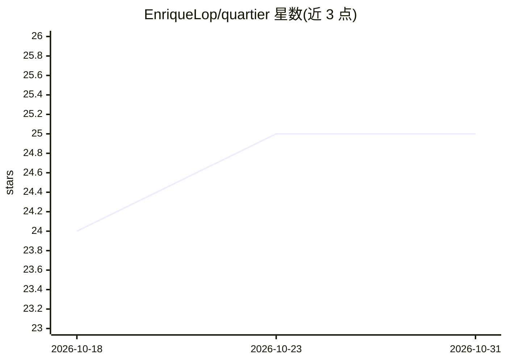

# EnriqueLop/quartier

⭐ 25 · JavaScript · MIT · 推送 2026-06-04 · [GitHub](https://github.com/EnriqueLop/quartier) · 个人维护

**把 AI 助手变成本地商家网站改版生意的工作流工具包**

面向无需编程技能的个人：提供一套 Docker 容器内运行的脚本与 PLAYBOOK.md 指令文件，供带终端访问能力的 AI 助手（如 Claude Code）调用。流程为：搜索 Google Maps 本地商家、评估其网站、抓取整站内容、由 AI 生成改版网站、展示前后对比，以此向商家收费。运行需 Docker、Google Places API key 与外部 AI 订阅；法律模板基于西班牙法律，需自行本地化。

## 筛选速览

| 维度 | 判定 | 备注 |
|---|---|---|
| AI 角色 | `ai-ecosystem` | LLM/agent 周边工具 |
| 许可风险 | `permissive` | MIT |
| 部署形态 | `self-host` | docker 或自建部署 |
| 模型依赖 | — | README 未给出锁定关系 |
| 硬件要求 | — | 无带数字的原话,不猜 |
| 安装摩擦 | `low` | 无编译、无系统依赖或容器化 |
| 成熟度 | — | 结构信号不足 |

## 能力要点

- Docker 容器内运行全部脚本，无需 npm install
- PLAYBOOK.md 向 AI 下达完整操作流程指令
- Google Maps 商家搜索与整站抓取、AI 生成改版网站
- 配套西班牙法律模板与按国家适配说明

## 适用场景

- 我不懂编程，想靠 AI 给社区商家做网站改版赚取收入
- 让 AI 助手搜索本地商家并自动生成网站改版方案
- 在非英语国家开展本地网站改版服务（模板与配置可本地化）

## 场景标签

`编码 Agent` `网页抓取` · 领域:效率与自动化

## 证据(README 行号)

> L34: - **An AI assistant** with terminal access (Claude Code, or any AI that can run shell commands)
> L63: Under the hood, the AI runs scripts via Docker — you don't need to know how they work. The `PLAYBOOK.md` file teach

## 星数曲线

2026-10-18 24 → 2026-10-31 25（+1）

---
*卡片 v1 · prompt 1.4 · 生成 2026-10-27 · 置信度 low · 依据 README sha `8766c3643678` · [字段定义](../../DATASET.md)*
