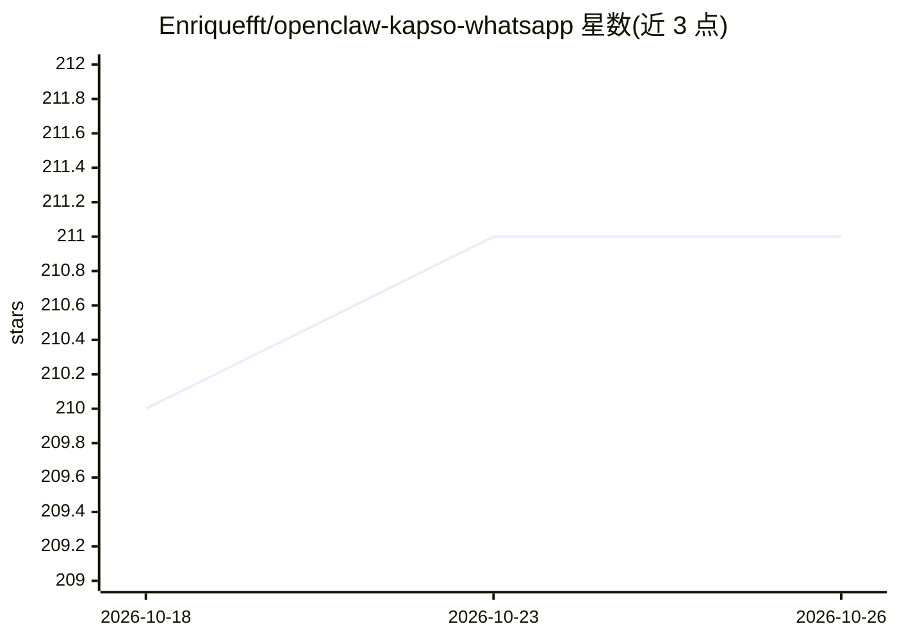

# Enriquefft/openclaw-kapso-whatsapp

⭐ 211 · Go · MIT · 推送 2026-03-29 · [GitHub](https://github.com/Enriquefft/openclaw-kapso-whatsapp) · 个人维护

**给 OpenClaw AI agent 接入 WhatsApp 号码的 Go 桥接服务**

由两个 Go 二进制组成的无状态桥接服务：通过 Kapso 统一 API 调用 Meta WhatsApp 官方 Cloud API，把入站消息转发给 OpenClaw Gateway 的 AI agent，并读取会话 JSONL 回发回复。支持轮询、Tailscale Funnel 与自有域名三种投递模式；内置发送者白名单、限速、角色标签与会话隔离；语音笔记可经 groq/openai/deepgram 或本地 whisper.cpp 转写。给运行 OpenClaw agent 的开发者使用，提供安装脚本、NixOS 模块与 go install 三种安装途径。

## 筛选速览

| 维度 | 判定 | 备注 |
|---|---|---|
| AI 角色 | `ai-ecosystem` | LLM/agent 周边工具 |
| 许可风险 | `permissive` | MIT |
| 部署形态 | `library` | 以包/库形式分发 |
| 模型依赖 | — | README 未给出锁定关系 |
| 硬件要求 | — | 无带数字的原话,不猜 |
| 安装摩擦 | `medium` | 含编译或系统依赖之一 |
| 成熟度 | — | 结构信号不足 |

## 能力要点

- 经 Kapso 调用 Meta 官方 WhatsApp Cloud API，无状态两个 Go 二进制
- 三种投递模式：轮询（默认）/ Tailscale Funnel / 自有域名
- 发送者白名单、每发送者限速、角色标签与会话隔离（默认开启）
- 语音转写支持 groq/openai/deepgram 云端与本地 whisper.cpp

## 适用场景

- 让我的 OpenClaw AI agent 拥有 WhatsApp 号码并收发消息
- 通过白名单与角色控制谁能在 WhatsApp 上与 agent 对话
- 把 WhatsApp 语音笔记转写后交给 agent 处理

## 场景标签

`聊天机器人` `语音识别` · 领域:对话与助手

## 证据(README 行号)

> L17: WhatsApp --> Kapso API --> kapso-whatsapp-bridge --> OpenClaw Gateway --> AI Agent
> L5: Give your OpenClaw AI agent a WhatsApp number.

## 星数曲线

2026-10-18 210 → 2026-10-26 211（+1）

---
*卡片 v1 · prompt 1.4 · 生成 2026-10-22 · 置信度 high · 依据 README sha `3949a9966fcb` · [字段定义](../../DATASET.md)*
