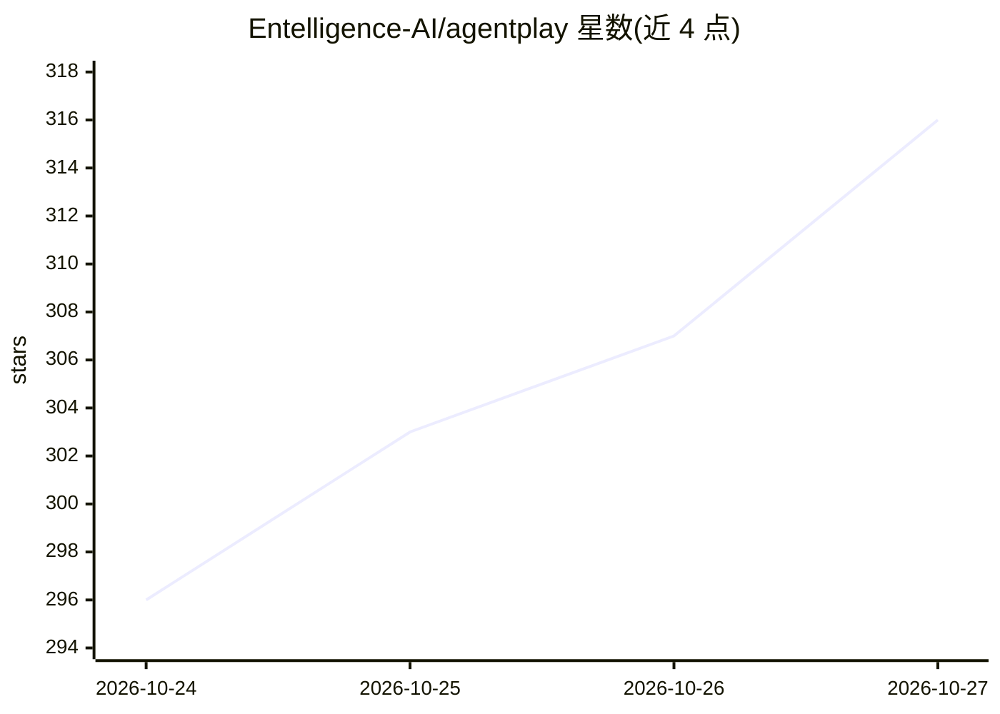

# Entelligence-AI/agentplay

⭐ 316 · Python · Apache-2.0 · 推送 2026-10-26 · [GitHub](https://github.com/Entelligence-AI/agentplay) · [官网](https://entelligence.ai/agentplay) · 组织维护

**本地回放编码 agent 会话的工具：把会话转成地图和时间线**

读取本机已有的编码 agent 会话记录（Claude Code、Codex、Cursor、GitHub Copilot、OpenCode、Kiro、Gemini CLI），为每个会话生成可回放的径向地图（文件、工具、MCP 服务器、子 agent、模型等触达对象）与时间线（编辑、错误、重试、token 与上下文等泳道），并在本地 127.0.0.1 打开查看器。地图默认做脱敏（不含提示词、工具输入输出、命令参数），支持路径哈希与单文件导出共享。面向使用编码 agent 的开发者；需 Python 3.11+，无运行时依赖，会话数据不离开本机，仅可选邮箱注册产生一次网络请求且可关闭。

## 筛选速览

| 维度 | 判定 | 备注 |
|---|---|---|
| AI 角色 | `ai-ecosystem` | LLM/agent 周边工具 |
| 许可风险 | `permissive` | Apache-2.0 |
| 部署形态 | `desktop` | 安装包/桌面程序 |
| 模型依赖 | — | README 未给出锁定关系 |
| 硬件要求 | — | 无带数字的原话,不猜 |
| 安装摩擦 | `low` | 无编译、无系统依赖或容器化 |
| 成熟度 | — | 结构信号不足 |

## 能力要点

- 一条 uvx agentplay 命令即可发现并回放本机 agent 会话
- 支持 8 种编码 agent 的会话格式（JSONL/SQLite）读取
- 地图默认脱敏：不含提示词、工具输入输出与命令参数，提供三种路径模式
- 本地运行，无遥测无上传，查看器仅监听 127.0.0.1

## 适用场景

- 回看我的 agent 到底读了什么、改了什么、哪些命令反复失败
- 定位上下文窗口何时填满、子 agent 带回了什么
- 把脱敏后的会话地图导出分享给队友评审

## 场景标签

`LLM 可观测性` · 领域:评测与运维

## 证据(README 行号)

> L10: **See what your coding agent actually did. Replay every session as a map and a timeline: what it read, what it edit
> L103: |Agent|Reads from (defaults)|Subagent lanes|Tokens|Notes|

## 星数曲线

2026-10-24 296 → 2026-10-27 316（+20）

---
*卡片 v1 · prompt 1.4 · 生成 2026-10-23 · 置信度 high · 依据 README sha `4395f28c8015` · [字段定义](../../DATASET.md)*
