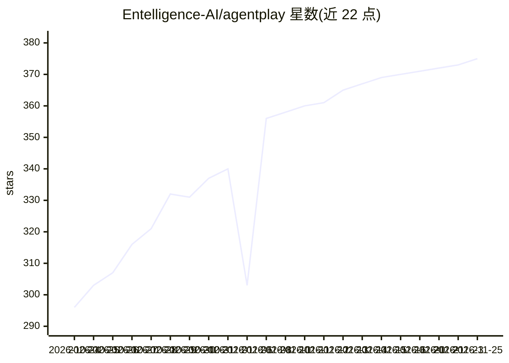

# Entelligence-AI/agentplay

⭐ 375 · Python · Apache-2.0 · 推送 2026-11-11 · [GitHub](https://github.com/Entelligence-AI/agentplay) · [官网](https://entelligence.ai/agentplay) · 组织维护

**回放编码 agent 会话的本地查看器：地图+时间线审计工具**

读取本机已存的编码 agent 会话记录（~/.claude、~/.codex、~/.cursor 等目录），为每个会话构建经脱敏的回放地图与时间线，展示读取的文件、编辑、命令失败、上下文窗口与子 agent 产出。以 uvx/pipx/pip 运行，除标准库外无运行时依赖，本地起 127.0.0.1 查看器；地图文件不含提示词与文件内容，支持 dirs_only/hashed 路径模式与单会话导出。面向使用 Claude Code、Codex、Cursor 等编码 agent 的开发者。

## 筛选速览

| 维度 | 判定 | 备注 |
|---|---|---|
| AI 角色 | `ai-ecosystem` | LLM/agent 周边工具 |
| 许可风险 | `permissive` | Apache-2.0 |
| 部署形态 | `desktop` | 安装包/桌面程序 |
| 模型依赖 | — | README 未给出锁定关系 |
| 硬件要求 | — | 无带数字的原话,不猜 |
| 安装摩擦 | `low` | 无编译、无系统依赖或容器化 |
| 成熟度 | — | 结构信号不足 |

## 能力要点

- 单命令 uvx agentplay@latest 扫描本机会话并打开本地查看器，无需账号与 API key
- 地图为径向树：文件、shell 动词、MCP 服务器、子 agent、模型、产出（commit/PR/ticket）
- 时间线支持 1x/4x/16x 回放、键盘快捷跳转与按任务/模型/子 agent 重新定界
- 隐私契约：会话数据不出本机，地图不含提示词文本与文件内容，支持路径脱敏模式

## 适用场景

- 排查 agent 编辑某文件前读过哪些文件、漏掉了什么
- 统计会话中重复失败并重试的命令
- 回放定位上下文窗口何时填满、子 agent 返回了什么
- 以脱敏地图形式向他人分享 agent 工作过程

## 场景标签

`LLM 可观测性` · 领域:评测与运维

## 证据(README 行号)

> L10: **See what your coding agent actually did. Replay every session as a map and a timeline: what it read, what it edit
> L28: Your agent's transcripts already record what it did: which files it read before editing, which commands it retried,
> L30: agentplay makes that data readable. Every session becomes a map of everything it touched and a timeline you can pla

## 星数曲线

2026-10-24 296 → 2026-11-25 375（+79）

---
*卡片 v1 · prompt 1.4 · 生成 2026-11-25 · 置信度 high · 依据 README sha `c0098ff57d9f` · [字段定义](../../DATASET.md)*
