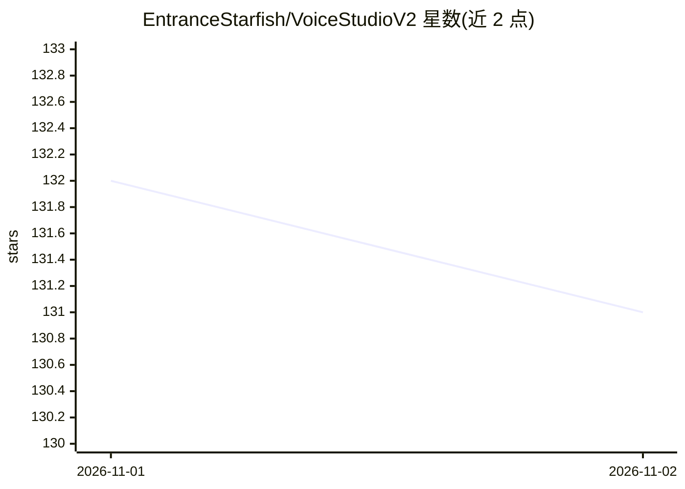

# EntranceStarfish/VoiceStudioV2

⭐ 131 · MIT · 推送 2026-10-30 · [GitHub](https://github.com/EntranceStarfish/VoiceStudioV2) · 个人维护

**本地 AI 语音工作室：实时变声、TTS、语音克隆与配音，带 OpenAI 兼容 API**

桌面应用，提供实时麦克风变声、多引擎文本转语音、语音克隆、多语言配音与听写转写；全部模型在本机运行，无需云服务或 API key。内置本地 HTTP 服务器，兼容 OpenAI audio API 格式，可将 tts-1、alloy 等名称映射到本地引擎与克隆声音，供 SillyTavern、Open WebUI 等应用作为语音后端。Windows/macOS/Linux 提供桌面安装包，模型经应用内目录安装；轻量模型无需 GPU，实时使用建议 NVIDIA GPU。为 debpalash/VoiceStudio 的非官方社区分支。

## 筛选速览

| 维度 | 判定 | 备注 |
|---|---|---|
| AI 角色 | `ai-native` | 本体是模型或模型工具 |
| 许可风险 | `permissive` | MIT |
| 部署形态 | `desktop` | 安装包/桌面程序 |
| 模型依赖 | — | README 未给出锁定关系 |
| 硬件要求 | — | 无带数字的原话,不猜 |
| 安装摩擦 | `medium` | 含编译或系统依赖之一 |
| 成熟度 | — | 结构信号不足 |

## 能力要点

- 实时麦克风变声，可经虚拟音频线用于 Discord/OBS/游戏
- 本地 OpenAI 兼容 API，OpenAI 模型名映射到本地引擎与克隆声音
- TTS、语音克隆、多语言配音、听写转写工具集成于单机
- 模型全部本地运行，应用内 Model Catalogue 安装并可随时切换

## 适用场景

- 直播、游戏语音或通话中实时使用另一声音说话
- 在支持自定义 OpenAI base URL 的应用中接入本地 TTS 后端
- 用短样本克隆声音并做视频多语言配音
- 离线进行听写与语音转文字

## 场景标签

`语音合成` `语音识别` · 领域:内容生成

## 证据(README 行号)

> L15: VoiceStudioV2 is a desktop app that puts a full voice toolkit on your own computer: speak in a different voice **li
> L31: - ⚡ Real-time voice conversion from your microphone
> L36: - 🧬 Voice cloning and voice design

## 星数曲线

2026-11-01 132 → 2026-11-02 131（-1）

---
*卡片 v1 · prompt 1.4 · 生成 2026-10-31 · 置信度 high · 依据 README sha `988bb0820062` · [字段定义](../../DATASET.md)*
