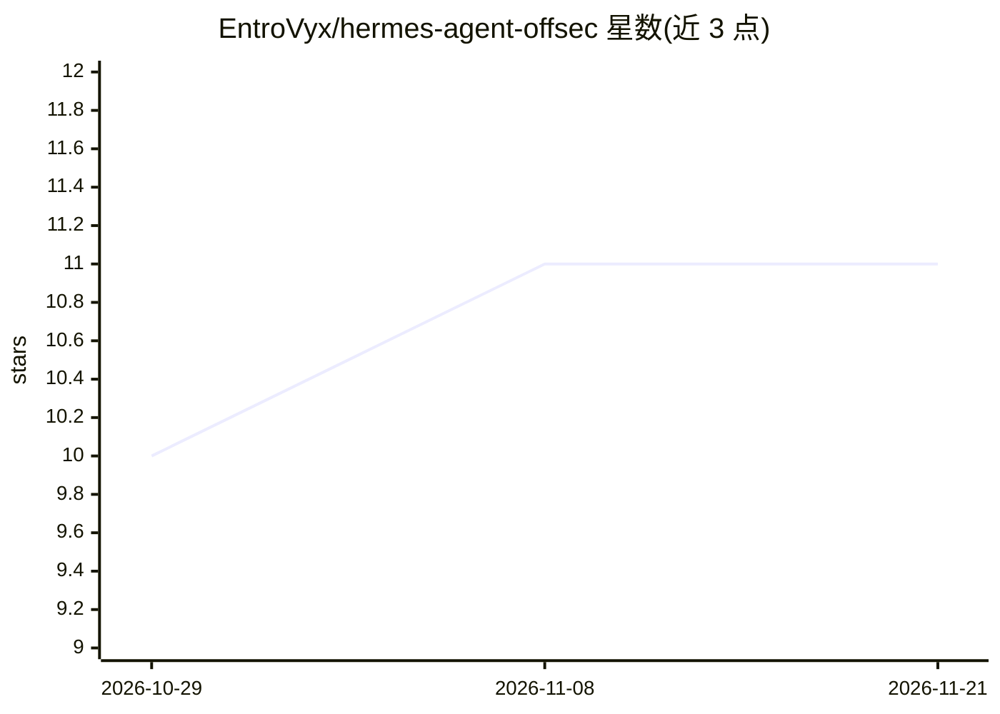

# EntroVyx/hermes-agent-offsec

⭐ 11 · Python · MIT · 推送 2026-07-20 · [GitHub](https://github.com/EntroVyx/hermes-agent-offsec) · 个人维护

**面向授权渗透测试与漏洞赏金的 AI 安全操作 agent**

HERMES-AGENT 的进攻性安全分支，将原通用个人 AI agent 的多面基础重构为安全操作工作流：提供 crown-jewel 目标定位、持久化目标档案、HAR/Burp 请求导入解析、可见化漏洞利用链引擎（primitive→pivot→impact）以及覆盖 recon/Web2/Web3/云/CI-CD/OAuth/GraphQL/SSRF/IDOR 等的技能库。通过 hermes CLI 的斜杠模式交互，数据存于 ~/.hermes-offsec/ 与上游隔离。README 未列出具体 LLM 提供商接入方式，仅提供 hermes model 命令选择提供商。

## 筛选速览

| 维度 | 判定 | 备注 |
|---|---|---|
| AI 角色 | `ai-native` | 本体是模型或模型工具 |
| 许可风险 | `permissive` | MIT |
| 部署形态 | `library` | 以包/库形式分发 |
| 模型依赖 | — | README 未给出锁定关系 |
| 硬件要求 | — | 无带数字的原话,不猜 |
| 安装摩擦 | `low` | 无编译、无系统依赖或容器化 |
| 成熟度 | — | 结构信号不足 |

## 能力要点

- 5 种斜杠攻击模式：/crown-jewel、/target-dossier、/request-import、/deep-hunt、/attack-chain
- HAR/Burp/Caido 请求导入并解析为端点簇、风险参数与建议攻击模式
- 跨会话持久化目标档案（actors、request maps、hypotheses、evidence）
- offsec 技能库覆盖 recon、Web2/Web3、云、CI/CD、OAuth/SAML、GraphQL、SSRF、IDOR 等

## 适用场景

- 授权漏洞赏金项目中从高影响目标开始组织狩猎
- 把 Burp/HAR 抓包流量转成端点与攻击假设
- 按业务流程（计费、恢复、GraphQL、角色等）做深度手动测试
- 把零散漏洞原语整理成可写入报告的利用链

## 场景标签

`网络安全` · 领域:学习与行业

## 证据(README 行号)

> L14: The original Hermes is a general-purpose personal AI agent. Hermes Agent Offsec keeps that strong multi-surface fou
> L27: - **Offsec skill library**: recon, Web2/Web3, cloud, CI/CD, OAuth/SAML, GraphQL, SSRF, IDOR, business logic, mobile
> L33: Inside `hermes`, use the slash modes below:

## 星数曲线

2026-10-29 10 → 2026-11-21 11（+1）

---
*卡片 v1 · prompt 1.4 · 生成 2026-11-19 · 置信度 mid · 依据 README sha `6b21f5529301` · [字段定义](../../DATASET.md)*
