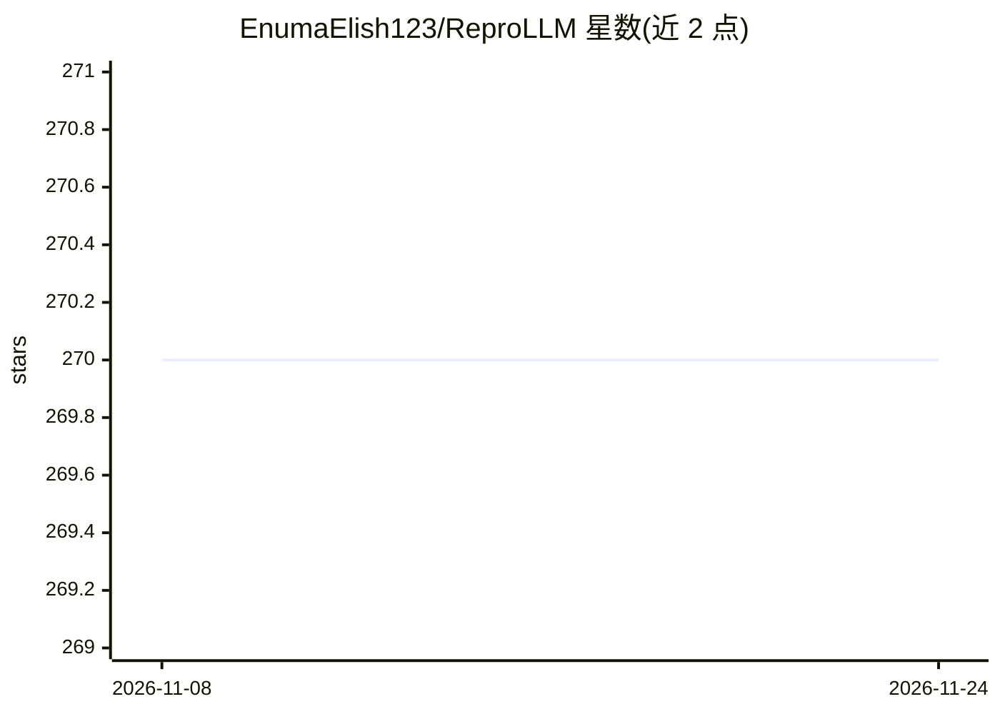

# EnumaElish123/ReproLLM

⭐ 270 · Python · Apache-2.0 · 推送 2026-11-07 · [GitHub](https://github.com/EnumaElish123/ReproLLM) · 个人维护

**LLM 实验可复现性工具：审计、锁存、记录与漂移比对**

面向 LLM 研究者的可复现性工具包，提供审计 CLI（reprollm audit）检查仓库状态与依赖固定情况、生成 manifest（reprollm init）、解析输入生成 lockfile（reprollm lock）、记录运行（reprollm run）、字段级语义比对两次运行差异（reprollm diff）并导出可审阅报告（reprollm export，含 NeurIPS 模板）。记录模型/分词器 revision、chat-template 哈希、提示哈希、生成参数、LLM-as-a-Judge 配置等状态，不安装模型权重或训练依赖，首次审计无需 GPU 或 API key。另有 Agent Skill 入口。

## 筛选速览

| 维度 | 判定 | 备注 |
|---|---|---|
| AI 角色 | `ai-ecosystem` | LLM/agent 周边工具 |
| 许可风险 | `permissive` | Apache-2.0 |
| 部署形态 | `library` | 以包/库形式分发 |
| 模型依赖 | — | README 未给出锁定关系 |
| 硬件要求 | — | 无带数字的原话,不猜 |
| 安装摩擦 | `low` | 无编译、无系统依赖或容器化 |
| 成熟度 | `idea` | |

## 能力要点

- 审计 CLI 将发现项关联到来源与修复建议
- manifest/lock/run 三层证据结构与字段级语义 diff
- 记录模型 revision、tokenizer 与 chat-template 哈希、提示哈希等 LLM 专属状态
- export 支持 NeurIPS 等模板生成可审阅报告

## 适用场景

- 分享实验前发现缺失的版本固定、提示或复现设置
- 结果变化时比对两次运行找出模型/提示/采样/环境的漂移
- 为论文 artifact 导出证据与限制说明
- 离线机器上用 --offline 锁存可用输入

## 场景标签

`科研工具` · 领域:学习与行业

## 证据(README 行号)

> L17: A reproducibility linter, experiment recorder, lockfile system, and drift detector for LLM research. It records the
> L20: ReproLLM works alongside your evaluation scripts and experiment tracker, with
> L77: **Fits your existing stack.** Keep MLflow, W&B or TensorBoard for metrics and

## 星数曲线

2026-11-08 270 → 2026-11-24 270（+0）

---
*卡片 v1 · prompt 1.4 · 生成 2026-11-17 · 置信度 high · 依据 README sha `10bd19271d42` · [字段定义](../../DATASET.md)*
