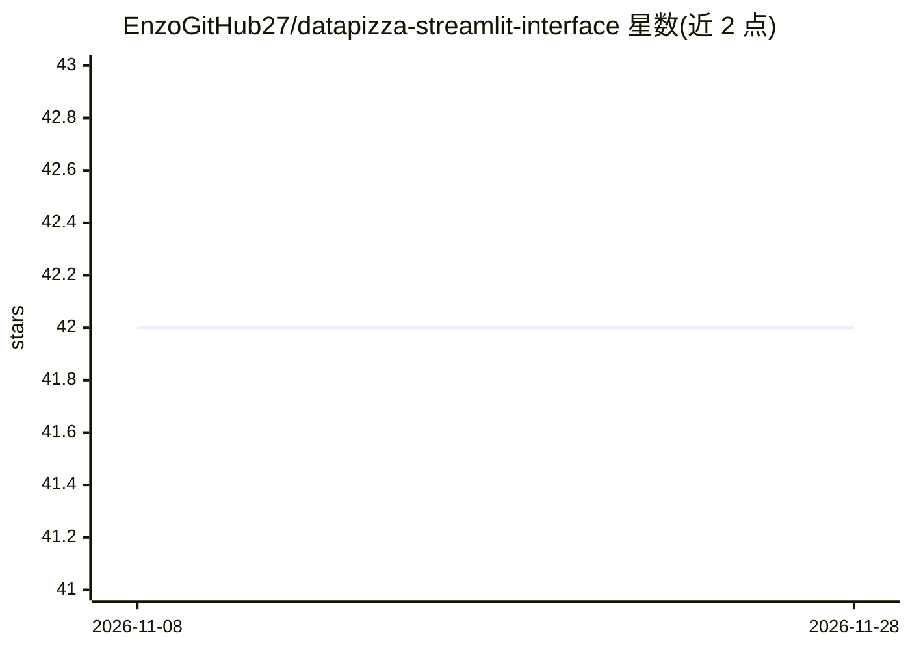

# EnzoGitHub27/datapizza-streamlit-interface

⭐ 42 · Python · MIT · 推送 2026-11-10 · [GitHub](https://github.com/EnzoGitHub27/datapizza-streamlit-interface) · [官网](https://deepaiug.vercel.app) · 组织维护

**面向终端用户的 Streamlit LLM 聊天界面，支持本地 Ollama 与云模型**

意大利社区 DeepAiUG 维护的 Streamlit 聊天应用：多提供商接入（本地 Ollama、Remote host、OpenAI 云，Anthropic/Google 需附加包，兼容 OpenAI 的自定义端点），提供 RAG 知识库（本地文档、Obsidian/LogSeq/Notion vault、MediaWiki/DokuWiki、对话沉淀的 Chat KB）、苏格拉底式提问按钮、仅本地运行的 Vision 与文件上传。隐私机制：云请求默认阻断 KB/附件/图片，可选混合模式下经本地 rizzo-pii 将个人数据替换为占位符后再发送。Windows/Mac/Linux 提供一键安装脚本，无需技术背景。

## 筛选速览

| 维度 | 判定 | 备注 |
|---|---|---|
| AI 角色 | `ai-native` | 本体是模型或模型工具 |
| 许可风险 | `permissive` | MIT |
| 部署形态 | `library` | 以包/库形式分发 |
| 模型依赖 | local-ok | 支持本地模型 |
| 硬件要求 | — | 无带数字的原话,不猜 |
| 安装摩擦 | `low` | 无编译、无系统依赖或容器化 |
| 成熟度 | — | 结构信号不足 |

## 能力要点

- 多提供商接入：Ollama 本地、Remote host、OpenAI 云及兼容 OpenAI 的自定义端点
- RAG 知识库覆盖本地文档、Obsidian/LogSeq vault、MediaWiki/DokuWiki 与 Chat KB
- 可选混合环境：rizzo-pii 在发送云端前将个人数据替换为占位符，返回后本地还原
- Vision 仅本地运行，图像不发送云端或公网 Remote host

## 适用场景

- 在本地 Ollama 上运行隐私优先的文档问答与聊天
- 把 Obsidian/LogSeq 笔记 vault 作为 RAG 知识库进行检索问答
- 需要向云端模型提问但要求先匿名化个人数据的场景

## 场景标签

`聊天机器人` `文档问答` `AI 助手` · 领域:对话与助手

## 证据(README 行号)

> L3: > Interfaccia Streamlit modulare per interagire con LLM locali (Ollama), remoti e cloud.
> L42: - 🤖 **Multi-provider**: Ollama (locale), Remote host, Cloud (OpenAI; Anthropic e Google con pacchetti aggiuntivi; e
> L48: - 📚 **Knowledge Base RAG** - Interroga documenti locali e wiki!

## 星数曲线

2026-11-08 42 → 2026-11-28 42（+0）

---
*卡片 v1 · prompt 1.4 · 生成 2026-11-18 · 置信度 mid · 依据 README sha `8860db6c1097` · [字段定义](../../DATASET.md)*
