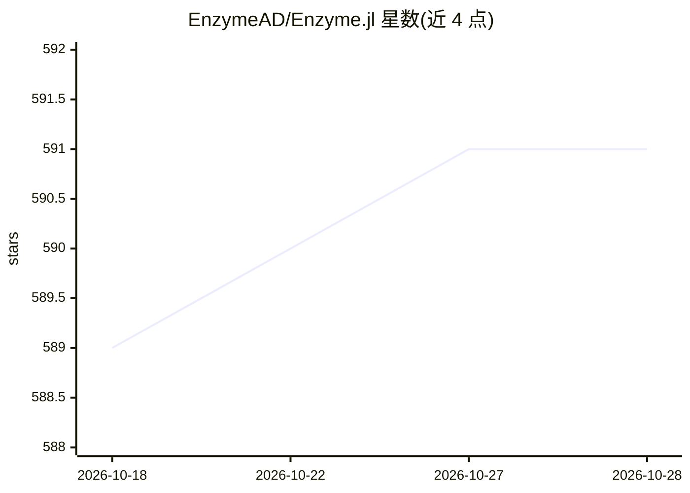

# EnzymeAD/Enzyme.jl

⭐ 591 · Julia · MIT · 推送 2026-10-23 · [GitHub](https://github.com/EnzymeAD/Enzyme.jl) · [官网](https://enzymead.github.io/Enzyme.jl/) · 组织维护

**Julia 语言的 LLVM 级自动微分绑定库**

Enzyme.jl 提供 Enzyme（LLVM 自动微分编译器插件）的 Julia 绑定。Enzyme 通过 LLVM 编译器插件对静态可分析的 LLVM 中间码做自动微分，可对优化后代码求导，通过 autodiff 函数调用实现对 Julia 函数的反向微分。以 Julia 包形式发布，用包管理器 ] add Enzyme 安装；README 自述为进行中的工作，欢迎提交 bug 报告；学术使用需引用两篇论文。

## 筛选速览

| 维度 | 判定 | 备注 |
|---|---|---|
| AI 角色 | `ai-ecosystem` | LLM/agent 周边工具 |
| 许可风险 | `permissive` | MIT |
| 部署形态 | `None` |  |
| 模型依赖 | — | README 未给出锁定关系 |
| 硬件要求 | — | 无带数字的原话,不猜 |
| 安装摩擦 | `low` | 无编译、无系统依赖或容器化 |
| 成熟度 | `idea` | |

## 能力要点

- LLVM 编译器插件实现自动微分
- 支持对优化后代码做 AD
- 提供 autodiff 接口对 Julia 函数求导
- 附 NeurIPS 论文引用（BibTeX）

## 适用场景

- 在 Julia 中对数值/科学计算函数求导
- 为可微编程与机器学习训练提供梯度
- GPU 与优化场景下的自动微分（见论文引用）

## 场景标签

`模型训练` · 领域:训练与推理

## 证据(README 行号)

> L8: This is a package containing the Julia bindings for Enzyme. This is very much a work in progress and bug reports/dis
> L10: Enzyme is a plugin that performs automatic differentiation (AD) of statically analyzable LLVM. It is highly-efficie

## 星数曲线

2026-10-18 589 → 2026-10-28 591（+2）

---
*卡片 v1 · prompt 1.4 · 生成 2026-10-21 · 置信度 high · 依据 README sha `9d33094c6fe5` · [字段定义](../../DATASET.md)*
