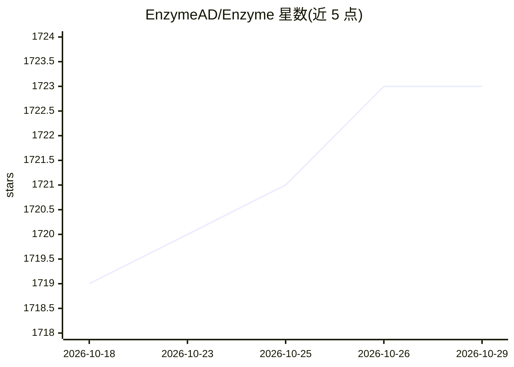

# EnzymeAD/Enzyme

⭐ 1,723 · LLVM · NOASSERTION · 推送 2026-10-27 · [GitHub](https://github.com/EnzymeAD/Enzyme) · [官网](https://enzyme.mit.edu) · 组织维护

**LLVM/MLIR 编译器自动微分插件，为 C/C++/Fortran 等生成梯度**

以 LLVM/MLIR 插件形式工作的自动微分工具：在代码中调用 __enzyme_autodiff 并运行转换 pass，即可将对函数的调用替换为其第一个参数的梯度，作用于静态可分析的 LLVM 与 MLIR 中间表示。面向使用编译器技术做可微编程的开发者与科研人员，可在优化后的代码上执行微分。安装方式包括源码 CMake/Ninja 编译及 Homebrew、Spack、Nix 包管理器，另有 Julia、Rust、Fortran 语言绑定。

## 筛选速览

| 维度 | 判定 | 备注 |
|---|---|---|
| AI 角色 | `ai-ecosystem` | LLM/agent 周边工具 |
| 许可风险 | `none` | NOASSERTION |
| 部署形态 | `None` |  |
| 模型依赖 | — | README 未给出锁定关系 |
| 硬件要求 | — | 无带数字的原话,不猜 |
| 安装摩擦 | `medium` | 含编译或系统依赖之一 |
| 成熟度 | — | 结构信号不足 |

## 能力要点

- 对静态可分析的 LLVM 和 MLIR 执行自动微分的编译器插件
- 在优化后的代码上执行 AD 转换
- 提供 Homebrew / Spack / Nix 包管理器安装方式
- 提供 Julia、Rust、Fortran 绑定

## 适用场景

- 在 C/C++ 等编译型语言项目中获得函数梯度而无需手写求导
- 可微编程与科学计算场景中对优化后代码做自动微分
- 通过 Julia/Rust/Fortran 绑定接入相应语言生态

## 场景标签

 · 领域:编译器/可微编程基础设施

## 证据(README 行号)

> L3: Enzyme is a plugin that performs automatic differentiation (AD) of statically analyzable LLVM and MLIR.
> L5: Enzyme can be used by calling `__enzyme_autodiff` on a function to be differentiated as shown below.
> L6: Running the Enzyme transformation pass then replaces the call to `__enzyme_autodiff` with the gradient of its first 

## 星数曲线

2026-10-18 1,719 → 2026-10-29 1,723（+4）

---
*卡片 v1 · prompt 1.4 · 生成 2026-10-21 · 置信度 high · 依据 README sha `299d2979c5f4` · [字段定义](../../DATASET.md)*
