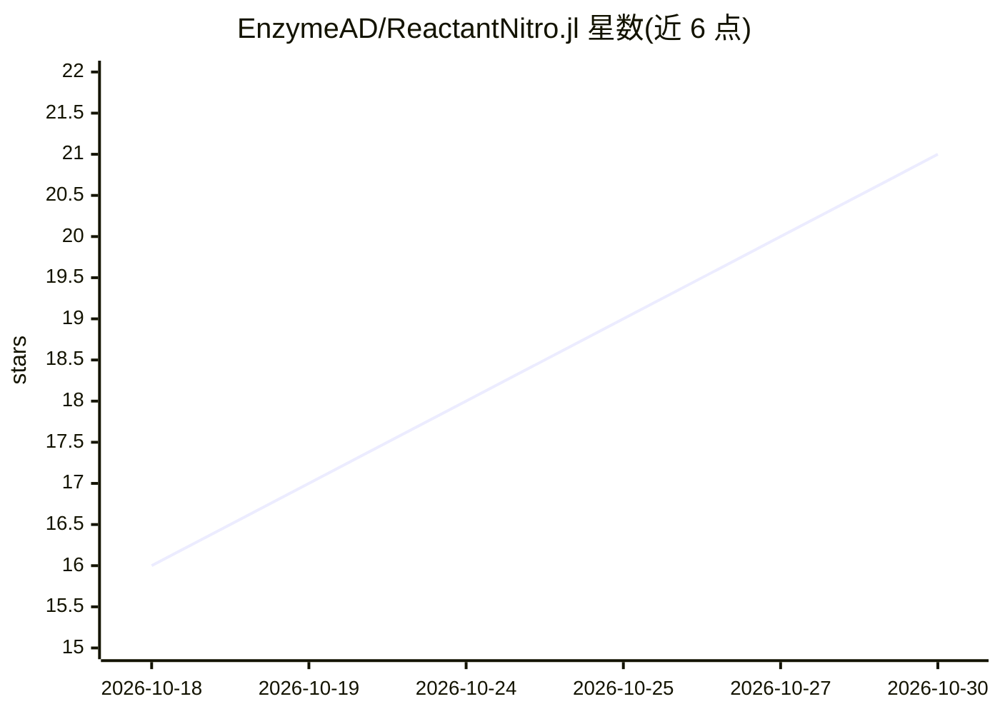

# EnzymeAD/ReactantNitro.jl

⭐ 21 · Julia · MIT · 推送 2026-10-27 · [GitHub](https://github.com/EnzymeAD/ReactantNitro.jl) · [官网](https://enzymead.github.io/ReactantNitro.jl/dev) · 组织维护

**面向 Lux 模型的 Reactant/XLA 训练框架，Julia 实现**

基于 Reactant.jl 与 Lux.jl 的 Julia 训练框架：将实验声明为带标记字段的 struct 加少量钩子，框架负责 XLA 编译的程序、设备传输、优化器、调度、梯度累积、checkpoint/恢复、日志与导出，并支持 SAM。通过 GraphConst/Device/Host 三种字段标记控制编译键与重编译行为。设计遵循 PyTorch Lightning，训练与推理服务全程在 Julia 内完成，需 Julia 1.12。

## 筛选速览

| 维度 | 判定 | 备注 |
|---|---|---|
| AI 角色 | `ai-ecosystem` | LLM/agent 周边工具 |
| 许可风险 | `permissive` | MIT |
| 部署形态 | `None` |  |
| 模型依赖 | — | README 未给出锁定关系 |
| 硬件要求 | — | 无带数字的原话,不猜 |
| 安装摩擦 | `low` | 无编译、无系统依赖或容器化 |
| 成熟度 | — | 结构信号不足 |

## 能力要点

- struct 声明实验，框架提供编译程序、优化器、调度与生命周期管理
- GraphConst/Device/Host 三类字段标记控制编译键与重编译
- 内置梯度累积、checkpoint/恢复、JSON Lines 日志与导出
- 针对 XLA 编译超时、陈旧程序复用、设备内存耗尽等场景设防护

## 适用场景

- 在 Julia 中用 Lux 模型做 Reactant/XLA 编译训练
- 需要 checkpoint、恢复与调度的长时训练实验
- 控制哪些实验字段参与编译键以避免误重编译

## 场景标签

`模型训练` · 领域:训练与推理

## 证据(README 行号)

> L15: ReactantNitro is a training framework for Julia, built on Reactant.jl
> L17: program is Reactant, and XLA runs it. You write the experiment as a struct plus a handful of hooks;

## 星数曲线

2026-10-18 16 → 2026-10-30 21（+5）

---
*卡片 v1 · prompt 1.4 · 生成 2026-10-28 · 置信度 high · 依据 README sha `c5d9ebbf2d2f` · [字段定义](../../DATASET.md)*
