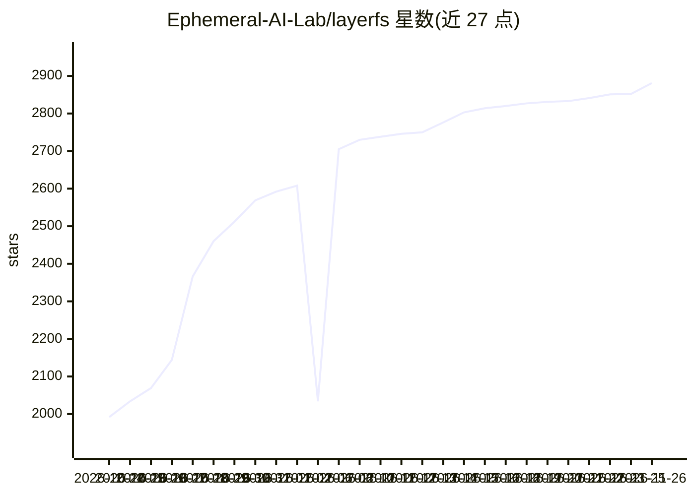

# Ephemeral-AI-Lab/layerfs

⭐ 2,881 · Rust · MIT · 推送 2026-11-25 · [GitHub](https://github.com/Ephemeral-AI-Lab/layerfs) · [官网](https://layerfs.ai/) · 组织维护

**为 agent 提供可写工作区与共享提交历史的 FUSE 文件系统**

LayerFS 基于 FUSE 为每个 agent 挂载完整可写的 Workspace，底层是单个 SQLite 文件构成的共享 Store；每次工具调用产生 Commit，写入进入 overlay，卸载后删除 overlay 但保留历史。支持 Branch 分叉、合并、冲突拒绝与 .lww 最新写入优先规则，内容按块去重存储。当前 Store 仅 Disposable 模式，无崩溃/断电持久化；1.1.0 API 拆分为 @layerfs/agent、@layerfs/backend、@layerfs/runtime，2.0.0 在独立分支开发。

## 筛选速览

| 维度 | 判定 | 备注 |
|---|---|---|
| AI 角色 | `ai-ecosystem` | LLM/agent 周边工具 |
| 许可风险 | `permissive` | MIT |
| 部署形态 | `None` |  |
| 模型依赖 | — | README 未给出锁定关系 |
| 硬件要求 | — | 无带数字的原话,不猜 |
| 安装摩擦 | `low` | 无编译、无系统依赖或容器化 |
| 成熟度 | — | 结构信号不足 |

## 能力要点

- 每次工具调用即 Commit，自动形成可回退的检查点历史
- 内容分块去重：157 个快照 100 MB，附带与 Btrfs+zstd 的对比测量
- 多 agent 共享一个无服务器的 Store，跨机器分叉/合并 Branch
- MIT 许可，提供 JavaScript SDK 与 layerfs 命令

## 适用场景

- 多个 agent 并行工作在同一项目上并各自提交变更
- 为 agent 执行环境提供带依赖的即时挂载工作区
- 回退到 agent 任意历史步骤的检查点

## 场景标签

`多智能体` `Agent 记忆` · 领域:Agent 开发

## 证据(README 行号)

> L7:  LayerFS is the substrate under your agents. Each one mounts a complete, writable
> L45: LayerFS runs today through **LayerFS × DSH**, the `dsh-layerfs` plugin for
> L126: - **Store.** One SQLite file holds every Branch, Commit and content object. Each

## 星数曲线

2026-10-24 1,992 → 2026-11-26 2,881（+889）

---
*卡片 v1 · prompt 1.4 · 生成 2026-11-23 · 置信度 high · 依据 README sha `49e0001e9926` · [字段定义](../../DATASET.md)*
