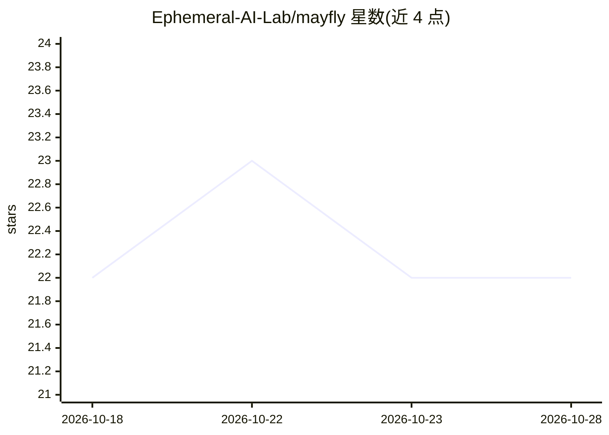

# Ephemeral-AI-Lab/mayfly

⭐ 22 · TypeScript · MIT · 推送 2026-10-22 · [GitHub](https://github.com/Ephemeral-AI-Lab/mayfly) · [官网](https://may-fly.dev) · 组织维护

**给 DeepSeek Harness（dsh）编码代理的终端 UI 前端**

Mayfly 是 DeepSeek Harness（dsh）的交互式终端 UI，以基于 dsh-base 的 Cordis out-of-tree bundle 形式构建（对应 Harness 0.2.1-rc.2，Mayfly 0.1.4-rc.2）。面向 dsh 用户与插件开发者：提供终端原生渲染（Markdown 表格、Mermaid、图表节点）、编辑器上方实时活动块（当前步骤、耗时、token 估算与输出速率）、/btw 侧对话与 /agents 子代理树浏览。插件复用 dsh 原生服务模型，通过 npm 安装，需设置 DEEPSEEK_API_KEY。

## 筛选速览

| 维度 | 判定 | 备注 |
|---|---|---|
| AI 角色 | `ai-ecosystem` | LLM/agent 周边工具 |
| 许可风险 | `permissive` | MIT |
| 部署形态 | `library` | 以包/库形式分发 |
| 模型依赖 | locked-api |  |
| 硬件要求 | — | 无带数字的原话,不猜 |
| 安装摩擦 | `low` | 无编译、无系统依赖或容器化 |
| 成熟度 | — | 结构信号不足 |

## 能力要点

- 终端原生渲染：Markdown 表格、Mermaid 及行/点/柱/迷你图/热图节点
- 编辑器上方实时活动块：当前步骤、轮次耗时、token 估算与输出速率
- /btw 侧对话与 /agents 子代理树共用同一 transcript 面板
- 插件与 dsh Web 采用同一模型：直接消费 ctx.commands / ctx.tools 等 dsh 服务

## 适用场景

- 在终端中以 TUI 界面使用 DeepSeek Harness 编码代理
- 为 dsh 开发与 Web 端同构的插件
- 在主对话之外并行开侧对话与子代理

## 场景标签

`编码 Agent` · 领域:编码与开发

## 证据(README 行号)

> L14: Mayfly is an interactive terminal UI for
> L15: DeepSeek Harness (`dsh`) —
> L17: `0.2.1-rc.2`. Mayfly `0.1.4-rc.2` deliberately uses the same plugin model

## 星数曲线

2026-10-18 22 → 2026-10-28 22（+0）

---
*卡片 v1 · prompt 1.4 · 生成 2026-10-27 · 置信度 high · 依据 README sha `4943a7c45172` · [字段定义](../../DATASET.md)*
