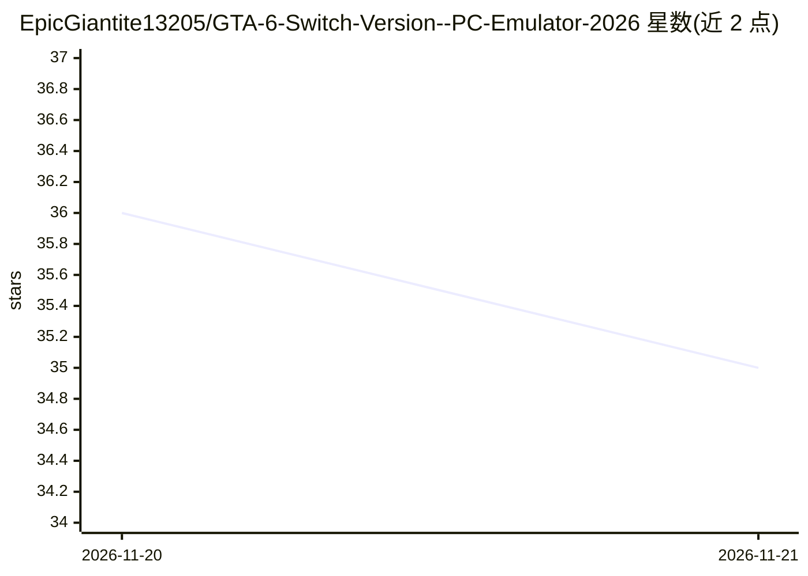

# EpicGiantite13205/GTA-6-Switch-Version--PC-Emulator-2026

⭐ 35 · Go · Apache-2.0 · 推送 2026-11-19 · [GitHub](https://github.com/EpicGiantite13205/GTA-6-Switch-Version--PC-Emulator-2026) · 个人维护

**面向 Windows 玩家的 GTA VI PC 版安装准备指南与配套工具**

一个针对尚未发布 PC 版的 Grand Theft Auto VI 的 Windows 准备资源：提供系统兼容性检查清单、GPU 驱动更新指引（NVIDIA/AMD/Intel 链接）、存储检查、Rockstar Games Launcher 准备步骤，以及图形设置、FPS 排障、安装错误分类等说明。README 明确说明配套安装器不含 GTA VI 游戏文件，游戏需经授权渠道获取；官方 PC 配置与发售日期均未公布，相关表格留空待更新。

## 筛选速览

| 维度 | 判定 | 备注 |
|---|---|---|
| AI 角色 | `ai-enhanced` | 去掉 AI 部分产品仍成立 |
| 许可风险 | `permissive` | Apache-2.0 |
| 部署形态 | `desktop` | 安装包/桌面程序 |
| 模型依赖 | — | README 未给出锁定关系 |
| 硬件要求 | — | 无带数字的原话,不猜 |
| 安装摩擦 | `low` | 无编译、无系统依赖或容器化 |
| 成熟度 | `idea` | |

## 能力要点

- Windows 兼容性准备清单（DirectX/驱动/存储检查）
- NVIDIA、AMD、Intel 官方驱动更新链接
- FPS 与卡顿问题的排障条目
- README 声明安装器不包含游戏文件

## 适用场景

- 提前准备 Windows 环境等待 GTA VI PC 版发布
- 排查 PC 游戏低 FPS 与卡顿问题
- 了解 Rockstar Games Launcher 的准备步骤

## 场景标签

 · 领域:游戏/桌面工具

## 证据(README 行号)

> L5: A dedicated PC installation and configuration resource for Grand Theft Auto VI, covering Windows preparation, graphi
> L49: The companion installer does not contain or install GTA VI game files.
> L238: No. The project installer is intended for a separate Windows setup companion. GTA VI must be acquired through an a

## 星数曲线

2026-11-20 36 → 2026-11-21 35（-1）

---
*卡片 v1 · prompt 1.4 · 生成 2026-11-20 · 置信度 mid · 依据 README sha `6954d37a13d3` · [字段定义](../../DATASET.md)*
