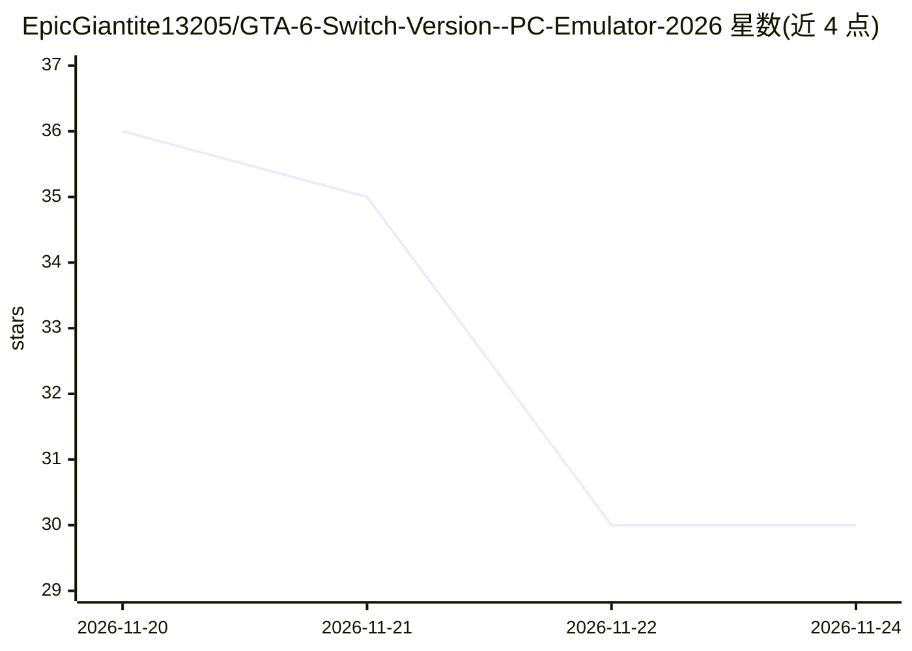

# EpicGiantite13205/GTA-6-Switch-Version--PC-Emulator-2026

⭐ 30 · Rust · Apache-2.0 · 推送 2026-11-21 · [GitHub](https://github.com/EpicGiantite13205/GTA-6-Switch-Version--PC-Emulator-2026) · 个人维护

**面向 Windows 用户的 GTA VI PC 版安装与配置准备指南**

一个面向 Windows 10/11 用户的 GTA VI PC 版准备工作资源，内容覆盖系统环境检查、显卡驱动配置、存储检查、Rockstar Games Launcher 准备、图形设置说明与 FPS 故障排查。README 自述其安装包为独立的 Windows 配套工具，不含且不安装 GTA VI 游戏文件；官方 PC 版发布日期与硬件要求截至文中日期尚未公布，需求表各项均标注未确认。

## 筛选速览

| 维度 | 判定 | 备注 |
|---|---|---|
| AI 角色 | `ai-knowledge` | 知识聚合/清单类 |
| 许可风险 | `permissive` | Apache-2.0 |
| 部署形态 | `desktop` | 安装包/桌面程序 |
| 模型依赖 | — | README 未给出锁定关系 |
| 硬件要求 | — | 无带数字的原话,不猜 |
| 安装摩擦 | `low` | 无编译、无系统依赖或容器化 |
| 成熟度 | — | 结构信号不足 |

## 能力要点

- Windows 兼容性检查清单（DirectX、驱动、存储、系统更新）
- 图形设置与 FPS/帧时间故障排查条目
- NVIDIA/AMD/Intel 官方驱动下载链接汇总
- 自述安装包不含游戏文件，游戏需经授权渠道获取

## 适用场景

- 在 GTA VI PC 版发布前准备与检查 Windows 环境
- 排查 PC 游戏常见的低 FPS、卡顿与显示问题
- 查阅 Rockstar Games Launcher 等官方资源链接

## 场景标签

 · 领域:游戏/安装配置指南

## 证据(README 行号)

> L3: ### GTA 6 PC Installation, Setup & Performance Guide
> L17: This repository is dedicated to Windows users preparing for the future PC edition of GTA VI.
> L238: No. The project installer is intended for a separate Windows setup companion. GTA VI must be acquired through an a

## 星数曲线

2026-11-20 36 → 2026-11-24 30（-6）

---
*卡片 v1 · prompt 1.4 · 生成 2026-11-22 · 置信度 low · 依据 README sha `2fe487426686` · [字段定义](../../DATASET.md)*
