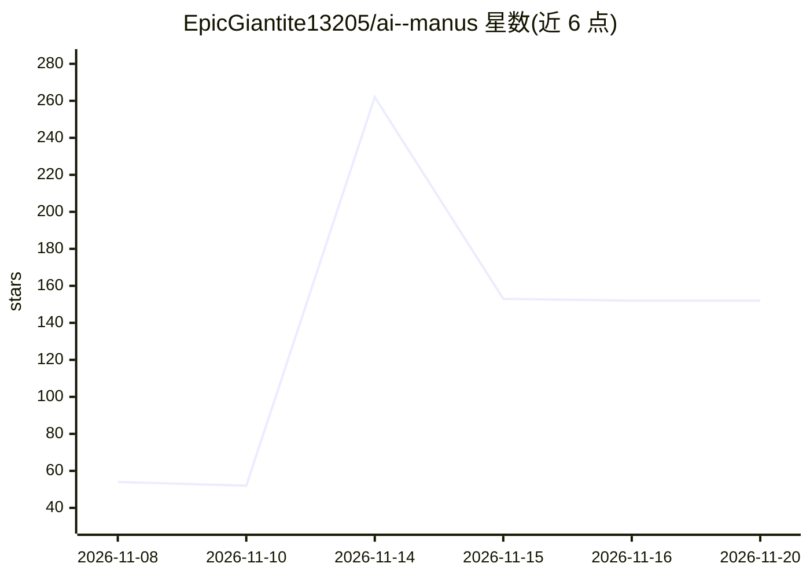

# EpicGiantite13205/ai--manus

⭐ 152 · Apache-2.0 · 推送 2026-11-19 · [GitHub](https://github.com/EpicGiantite13205/ai--manus) · 个人维护

**面向个人用户的自主 AI Agent：自动执行代码与浏览器操作**

README 以营销化文字描述一个名为 Manus 的自主 AI 代理：可代替用户编写并执行脚本、控制浏览器导航网页与填写表单、执行多步骤日常任务，定位为家庭、学习与轻量办公场景的后台个人助手。全文未给出技术实现细节、模型接入方式、安装命令或代码结构；仅提供下载入口与硬件兼容表（最低 4GB 内存、双核 CPU）。主题标签提及 openai/anthropic 等，但正文无对应接入说明。

## 筛选速览

| 维度 | 判定 | 备注 |
|---|---|---|
| AI 角色 | `ai-native` | 本体是模型或模型工具 |
| 许可风险 | `permissive` | Apache-2.0 |
| 部署形态 | `None` |  |
| 模型依赖 | — | README 未给出锁定关系 |
| 硬件要求 | — | 无带数字的原话,不猜 |
| 安装摩擦 | `low` | 无编译、无系统依赖或容器化 |
| 成熟度 | — | 结构信号不足 |

## 能力要点

- 自主执行代码与脚本
- 浏览器控制：导航网页、填写表单、采集信息
- 面向家庭/学习/轻量办公的多步骤任务自动化
- 给出最低/推荐硬件兼容表（4GB 内存起步）

## 适用场景

- 让代理代替我完成重复的网页操作与表单填写
- 学习场景下整理研究笔记、运行小脚本
- 轻量办公中跨多页面收集信息并汇总

## 场景标签

`AI 助手` `浏览器自动化` `编码 Agent` · 领域:效率与自动化

## 证据(README 行号)

> L10: - **Autonomous Code Execution:** Manus AI agent runs code on its own to complete tasks, so you can focus on decisio
> L18: Manus is an autonomous AI agent designed to run code and control a browser on your behalf. Instead of acting like a

## 星数曲线

2026-11-08 54 → 2026-11-20 152（+98）

---
*卡片 v1 · prompt 1.4 · 生成 2026-11-17 · 置信度 low · 依据 README sha `3ae3f682d640` · [字段定义](../../DATASET.md)*
