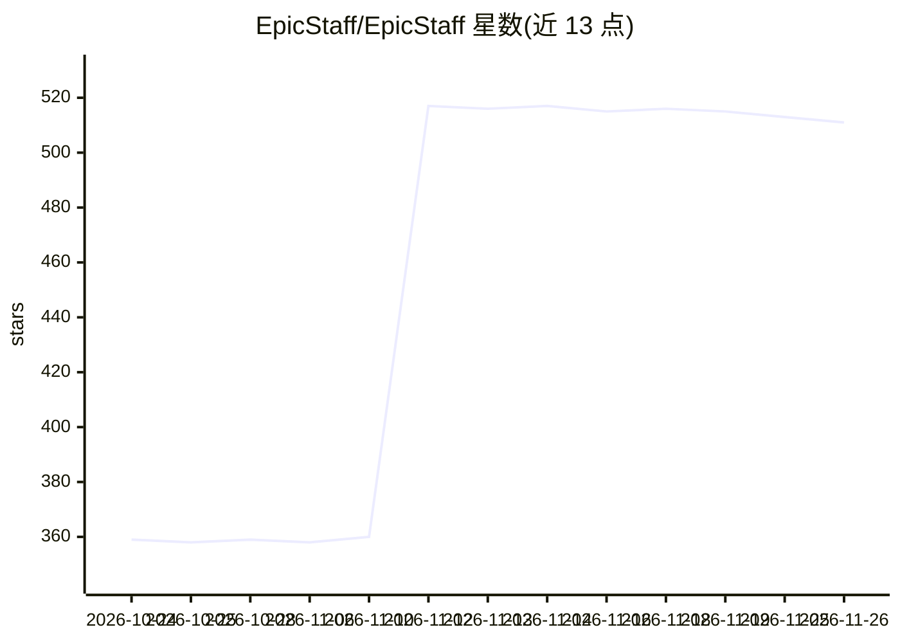

# EpicStaff/EpicStaff

⭐ 511 · Python · NOASSERTION · 推送 2026-11-25 · [GitHub](https://github.com/EpicStaff/EpicStaff) · [官网](https://www.epicstaff.com/) · 组织维护

**给运营团队构建 AI agent 流程的自托管可视化编排平台**

基于 Django 后端的自托管、source-available 平台，通过可视化拖拽编辑器设计 AI agent 流程，并可在节点中注入自定义 Python 逻辑。内置 Redis/PostgreSQL 持久化 agent 记忆、状态管理、会话审计与沙箱执行，通过 MCP 接入内部系统。定位为让运营团队拥有并审查流程、工程师负责系统集成；运行需 Docker Desktop 与 Git，快速部署命令按 Windows/macOS/Linux 分别给出，并提供生产配置生成脚本。

## 筛选速览

| 维度 | 判定 | 备注 |
|---|---|---|
| AI 角色 | `ai-ecosystem` | LLM/agent 周边工具 |
| 许可风险 | `none` | NOASSERTION |
| 部署形态 | `desktop` | 安装包/桌面程序 |
| 模型依赖 | — | README 未给出锁定关系 |
| 硬件要求 | — | 无带数字的原话,不猜 |
| 安装摩擦 | `low` | 无编译、无系统依赖或容器化 |
| 成熟度 | — | 结构信号不足 |

## 能力要点

- 拖拽式可视化流程编辑器，节点内可注入自定义 Python 逻辑
- 内置 Redis/PostgreSQL 跨会话持久化 agent 记忆
- 会话账本、沙箱执行与每 agent 权限等治理机制
- 发布镜像经 Sigstore cosign 签名并附带 SBOM 可验证

## 适用场景

- 让运营团队无需工程介入即可查看与修改 agent 流程
- 自托管部署并审计 agent 每一步决策
- 通过 MCP 与 Python 将 agent 流程接入内部系统

## 场景标签

`工作流自动化` · 领域:效率与自动化

## 证据(README 行号)

> L18:  EpicStaff is a platform for building AI agent flows that operations teams own.
> L20: The deployment model is self-hosted and source-available. Engineers connect EpicStaff to your internal systems thro
> L43: * **Django Multi-Agent Backend:** Powered by Django for robust, low-latency, and production-ready Pythonic agent or

## 星数曲线

2026-10-24 359 → 2026-11-26 511（+152）

---
*卡片 v1 · prompt 1.4 · 生成 2026-11-26 · 置信度 high · 依据 README sha `bff3769190f5` · [字段定义](../../DATASET.md)*
